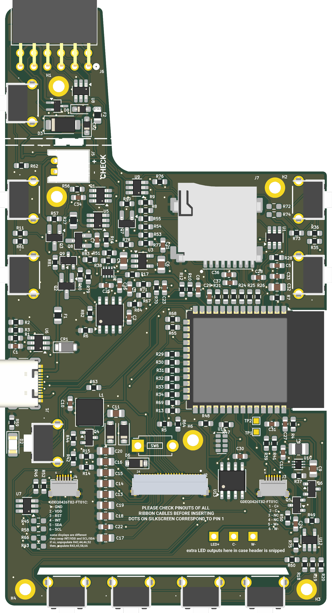
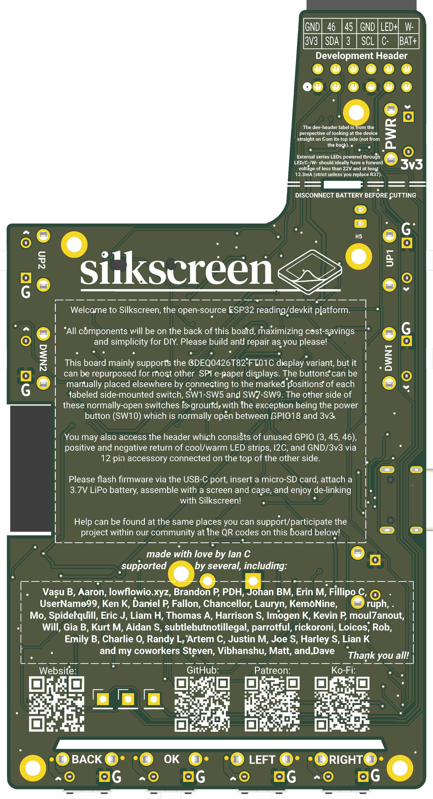

# Silkscreen

**An open-source, open-hardware e-reader mainboard.**

Silkscreen is an open e-paper development board. You can build a pocket reader around it,
adapt its firmware or extend the electronics; this repository covers the mainboard. A factory
can assemble the board for you, and you add a compatible e-paper display, battery, microSD card
and case. It is a 2-layer ESP32-S3 board with a 24-pin display connector,
optional touch and frontlight, microSD and single-cell Li-ion/LiPo power.

It is the successor to [de-link](https://de-link.me). The de-link project hub's pages and photos
are kept on the [`de-link-old`](https://github.com/iandchasse/silkscreen-pcb/tree/de-link-old)
branch. I designed Silkscreen in KiCad 9, but
**you do not need KiCad to order a board.** Every file a factory asks for is in the
`production/` folder of this repository, ready to upload.

| Back (all components) | Front (silkscreen art) |
|:---:|:---:|
|  |  |

## What it is

- **Brain:** an ESP32-S3 module with 16 MB of flash and 8 MB of PSRAM, with USB built in. You
  plug a USB-C cable straight into it, no adapter.
- **Screen:** a 24-pin connector for SPI e-paper panels. The primary target is Good Display's
  4.26" panel family, in plain, touch, frontlight, or touch + frontlight versions. The plain panel
  is sold as `GDEY0426T82`; the others are `GDEQ0426T82` with a suffix for the variant (`-T01C`
  touch, `-FL01C` front light, `-FT01C` both), so always order by the full part number.
- **Power:** charges and runs from a single-cell Li-ion/LiPo pack over USB-C, with charger,
  cell protection and a 3.3 V regulator on board.
- **Storage:** a push-push microSD socket.
- **Buttons:** eight page/navigation buttons, plus power and reset.
- **Size:** 60.05 × 111.30 mm, 1.6 mm thick. Every part is soldered onto the **back** face, so
  the front is clear for the display.

Silkscreen is built to run the open firmware made for Xteink's readers, starting with CrossPoint.
Setting them up for this board is closed-beta work, so there is **no firmware release for it
yet**. Read [Firmware](#firmware) before you order.

The complete picture of the project, the story behind it, the cost breakdown and the build
configurator are on the project website, [silkscreenreader.com](https://silkscreenreader.com).
The current [site preview](https://de-link.me/silkscreen-test) includes the builder and beta plans.

Everything about how the board works, pin by pin, is in one document:
[docs/HARDWARE.md](docs/HARDWARE.md). It covers every circuit block, the GPIO map, what firmware
has to do for the hardware, and the dimensions a case needs.

---

## What you need besides the board

The factory sends you a populated circuit board and nothing else. You also need:

| Item | What to get |
|---|---|
| **Display panel** | One of the 4.26" Good Display variants: `GDEY0426T82` (plain), `GDEQ0426T82-T01C` (touch), `-FL01C` (frontlight), `-FT01C` (touch + frontlight). The panel you pick decides which optional parts you fit. See [Choosing a configuration](#choosing-a-configuration). |
| **Battery** | A protected **single-cell** (3.7 V nominal / 4.2 V charged) Li-ion or LiPo pack fitted with a **JST-PH 2.0 mm, 2-pin** plug. Its manufacturer's limits must permit 4.2 V charging at the board's approximately 0.25 A charge current. Read the polarity note below before you plug it in. I use [this 500 mAh `503035` pack (5 × 30 × 35 mm, JST-PH 2.0)](https://www.amazon.com/dp/B0GDQLLF12). It fits the board's 38.75 × 30.50 mm battery bay snugly. If a cell requires a lower charge current, adjust `R6` and verify the resulting current against its specifications ([HARDWARE.md §3.2](docs/HARDWARE.md#32-battery-charger)). A matching size, plug or protection board alone does not establish compatibility. |
| **microSD card** | Any normal microSD card. The battery normally sits in the board's cut-out directly in front of the card slot, so you lift or slide the cell aside to put a card in or take one out. I designed it that way; the card is not meant to be swapped often. |
| **USB-C cable** | A **data** cable, not a charge-only one, or the board will charge but never appear on your computer. |

**Battery lead order.** On the board, `J5` pin 1 is battery **negative** and pin 2 is battery
**positive**, and the board prints **- +** with the word **CHECK** right beside the connector's
mouth. A pack's wire colors are a good guide (black is negative, red is positive), but there is
no industry standard for which side of a JST-PH plug each wire goes in: packs ship both ways
round, and the two look identical in a photo. So before you plug a pack in, with USB unplugged,
check that its black wire lines up with the **-** mark and its red wire with the **+**. If they are
the wrong way round, swap the two wires in the plug
([how to reverse a JST battery plug](https://www.digikey.com/en/maker/blogs/2025/reversing-the-polarity-on-lipo-battery-jst-connectors)).
A multimeter is the surest check.

> [!WARNING]
> Lithium cells are a fire risk if reversed, shorted or crushed. Check your pack against the
> **- +** marks beside `J5` before plugging it in, and measure it if you can. Use a pack with its
> own protection board. Stop using any cell that is puffed, hot or damaged.

**Screws and case are not on this list.** The board has six M2 mounting holes, but which screws
you need depends on the case you use, and no case is supplied here. See
[The board and your case](#the-board-and-your-case).

---

## Order an assembled board, step by step

> [!CAUTION]
> **Silkscreen has working prototypes, and the closed beta is underway.** This board should work, but
> building one is at your own risk: a mistake I have not found yet could mean a board that does
> not work, and the factory does not refund a board that was built exactly as the files said. If
> you have concerns or questions, join the [Discord](https://discord.gg/zCnKFt4Y4P) before you
> order.
>
> Build your own board to participate; there is no email application. The builder supplies
> the files for your configuration. Check its current firmware support and build instructions
> before ordering.
>
> **If your board has no `R84` resistor** (it was made from older files), power it from a USB-C
> charger, an ordinary USB-A charger or a PC port rather than a fast-charge USB-A brick on a short,
> thick cable ([HARDWARE.md §3.1](docs/HARDWARE.md#31-usb-c-input--protection)), check `J6`'s pins
> with a meter ([§11](docs/HARDWARE.md#11-expansion-header)), and add two wires after a cut (see
> [below](#cutting-the-board-down-for-a-smaller-display)). The files in `production/` are Rev 1.02:
> they add `R84`, a 3V3 link and ground vias, a 12-pad SMD USB-C socket in place of the
> through-hole one, and a charge-enable gate fed from `USB_VBUS` (`R79` to `R82` changed), and have
> not been built yet. (Files labelled Rev 1.01 were published on 2026-10-01 and never ordered;
> Rev 1.02 replaces them.)
>
> Your screen panel and battery are not part of the board order: see
> [What you need besides the board](#what-you-need-besides-the-board). You can start on an
> enclosure design from the STEP model in
> [The board and your case](#the-board-and-your-case); the `#enclosure-design` channel on the
> Discord is where case work is being shared and discussed.

You do not need KiCad and you do not need to know how a PCB is designed. A factory makes the
board and solders every part onto it. You will be clicking through a web shop and uploading three
files that are already in this repository. Unfamiliar words are defined in
[Words used on the factory's website](#words-used-on-the-factorys-website).

> **Or let the builder make the files.** The *Build one* page on the website walks you through
> the panel variant and the optional blocks, estimates what the result costs, and gives you the
> three upload files for exactly that build: the same Gerber zip, plus a BOM and CPL with the
> parts you left off removed (see [Choosing a configuration](#choosing-a-configuration)). For the
> full build they are exactly the files in `production/`. The steps below are the same either way.

### What it costs and how long it takes

The minimum order is **5 bare boards**, and you choose how many of them the factory assembles:
as few as **2**, all 5, or more boards if you want them. Most of the bill is one-off (the bare
boards, setup, the solder stencil, and a small loading fee for each of about two dozen "Extended"
part types the factory has to fetch), so the price per assembled board falls quickly as you build
more. The website's cost page breaks the cost down by order size and explains where each fee
comes from.

For scale, my own order (no coupons, US delivery): five boards with two
assembled came to **$223.95** for boards, parts and assembly, and **$305.23** at checkout once
shipping, US tariffs and tax were added. That is about $150 per working board at two, and the
cost page puts the same build at roughly $77 per board with all five assembled and about $50 at
ten. Prices, shipping and import charges move, so treat every figure as an estimate.

| | |
|---|---|
| Time from clicking *order* to the parcel | about **2 to 3 weeks** |
| Not included | display panel, battery, microSD card, case |

### Step 1: get the three files

Download this repository (green **Code** button, then **Download ZIP**) and unzip it. Everything
you need is in the `production/` folder. You upload exactly three files:

| Upload this | What it is | Where it goes |
|---|---|---|
| `production/Silkscreen_Reader_PCB_1.02.zip` | the **Gerber** files: the board itself, meaning copper layers, outline and hole positions | the *Add Gerber file* box |
| `production/jlc_bom.csv` | the **BOM** (bill of materials): the shopping list of parts | the *Add BOM file* box |
| `production/positions.csv` | the **CPL** (also called the centroid or pick-and-place file): where each part sits and which way it faces | the *Add CPL file* box |

Ignore everything else in that folder. These three belong together and come from the same export.
Do not mix one of them with an older copy of another.

### Step 2: order the bare board

1. Sign in at [jlcpcb.com](https://jlcpcb.com), click **Order now**, then **Add Gerber file** and
   choose `Silkscreen_Reader_PCB_1.02.zip`.
2. The viewer draws the board. Confirm it says **2 layers** and about **60 × 111 mm**. If it does
   not, you uploaded the wrong file.
3. Set **PCB Qty = 5**, **Thickness = 1.6 mm**, **Outer Copper Weight = 1 oz**. Surface finish and
   solder-mask color are your choice; nothing in this design needs a particular one.
4. Leave everything else at its default.
5. Scroll the viewer to the board edges and check the USB-C cut-out, the microSD opening and the
   two narrow slots on the outline are open, not filled. The long one is the display-flex slot;
   the short one is at the tongue neck. Both are wider than JLCPCB's 1.0 mm minimum routed-slot
   width, so neither should raise a design-for-manufacture (DFM) message.

### Step 3: turn on assembly

**PCBA** means "printed circuit board assembly": the factory buys the parts and solders them on
for you, instead of shipping you a bare board.

1. Switch **PCB Assembly** on.
2. Choose **Standard**, not Economic. JLCPCB runs two assembly services, and the ESP32-S3 module
   this board is built around can only be placed on **Standard**, so for a complete board Standard
   is the one you need. (If you are happy to hand-solder the module yourself, you could leave it
   off the order and use the cheaper Economic service for everything else. That is an experienced
   builder's choice, not the path I recommend.)
3. Because this board is 60 mm wide and Standard's conveyor wants at least 70 mm, the factory may
   add **snap-off edge rails**: narrow strips of extra board material along the edges for the
   machine to grip. There is nothing for you to design. Expect a small fee in the quote, and snap
   the rails off when the boards arrive.
4. Set **Assembly side: Bottom**. Every part on this board is on the back. If you leave this on
   *Top* you will receive blank boards and a bag of parts.
5. Set the assembly quantity to the number of boards you want built, from 2 up to the number of
   bare boards in the order.
6. Leave **Tooling holes** on *Added by JLCPCB*.
7. Set **Confirm Parts Placement** to **Yes**. It costs a small fee and is worth it on a first
   order: it lets you look at a picture of where each part will go before the machine runs.
8. Click **Confirm**, then **Next**.

### Step 4: upload the parts list

1. **Add BOM file**: `production/jlc_bom.csv`
2. **Add CPL file**: `production/positions.csv`
3. Click **Process BOM & CPL**.

### Step 5: check the parts the factory picked

You get a table with one row per part. Most rows will be matched.

- **Rows with a blank part number are meant to be blank.** These references (`TP3 TP4 TP5`,
  `R43 R45 R58 R66 R72 R74`, `SW6` and `U14`, the alternate clock chip; the board uses `U13`) are
  tagged *"DNP (standard build)"*. **DNP** means "do not populate": a spot on the board
  deliberately left empty. **Leave them unselected.**
- **Every other row must show a match.** If a row says *No Parts Selected* or *out of stock*, or
  shows a manufacturer's part number instead of an **LCSC code** (the `C…` number that identifies a
  part in the factory's own warehouse), click **Search** and look it up.
  [`fabrication/BOM.md`](fabrication/BOM.md) lists an approved alternative for every part on this
  board. Use that list rather than picking a look-alike yourself, because several of these parts
  have near-identical siblings with different pinouts.
- The part most often short is **TPS923610DRLR** (`U10`, LCSC `C52919131`), the frontlight driver.
  Check its stock. If you are not fitting a frontlight panel, untick it along with the rest of the
  *Frontlight* group in [Choosing a configuration](#choosing-a-configuration). If you *are* fitting
  one and it is out of stock, see [If the frontlight driver is out of stock](#if-the-frontlight-driver-is-out-of-stock).
- If you are deliberately leaving a block off, remove its parts from the BOM **and** the CPL, or
  untick them here.
- Click **Next**.

#### If the frontlight driver is out of stock

JLCPCB's stock of the TPS923610DRLR comes and goes, and restocking is unpredictable. It isn't a
dead end, just a slower one. In order of preference:

1. **Pre-order it through JLCPCB.** Any account can do this; it just takes lead time. While LCSC
   lists several suppliers for this part, the wait should be short.
   1. Sign in to JLCPCB and open **Parts Manager → Order Parts**.
   2. Search `C52919131`. Enter the quantity you need, plus one or two spares, and add it to
      **My Parts Lib**.
   3. Go to the cart and check out within the hour, or the cart is cancelled. JLCPCB emails the final
      price within 48 hours and refunds or charges the difference.
   4. Wait until the parts reach JLCPCB's warehouse. Pre-ordered parts can't be used before then,
      and they are never shipped to you; they only go into your assembly orders.
   5. Place the board order as above. At Step 5, `U10` matches from your private library.

   JLCPCB's own guide: [What is JLCPCB Parts Pre-order Service?](https://jlcpcb.com/help/article/What-is-JLCPCB-Parts-Pre-order-Service)
   · [Pre-ordering terms](https://jlcpcb.com/help/article/pre-ordering-parts-terms-conditions)

2. **If you can't pre-order it, swap two parts, not one:**

   | Ref | Stock part | Swap to |
   |---|---|---|
   | `U10` | TPS923610DRLR | **TPS923611DRLR** |
   | `D3` | SMAJ26A | **SMAJ33A** |

   The TPS923611 shares the TPS923610's datasheet, package (SOT-563, `DRL`), pinout and 1.8 A switch
   limit, so it fits the same footprint. The one difference is its output ceiling: about 30 V, with
   over-voltage protection at 29.6–31.4 V, where the TPS923610 stops at about 24.5 V. The stock
   `D3`, an SMAJ26A clamp on `LED_SW`, starts conducting at 28.9 V. With a TPS923611 and the stock
   `D3`, a disconnected light lets the driver push current into `D3` before its own protection trips,
   and `D3` can burn out. An SMAJ33A doesn't conduct until about 36.7 V, so the driver's protection
   trips first. Don't leave `D3` off instead: it protects the light connectors (`J3`, `J6`).

   Treat this as the second choice. Its higher ceiling leaves `C9` charged to a higher voltage after an open-load
   trip, so with one light string open and the other intact, a colour change dumps a larger pulse into the driver's
   feedback pin. [HARDWARE.md §13.1](docs/HARDWARE.md#131-firmware-contract--things-the-board-needs-firmware-to-do)
   lists the firmware rule that avoids it; if you can wait for a pre-order, do that instead.

   The **TPS923612** is not an option: it only comes in a 2 × 2 mm WSON (`DRV`) package, which
   doesn't fit this footprint.

### Step 6: check the placement preview (do not skip this)

You see a drawing of the board with every part on it. This is your last chance to catch a part
that is rotated wrongly. A matched part code does not prove the part is the right way round.
The parts below are the ones most often turned or offset in JLCPCB's preview; check them.

| Part | What to check |
|---|---|
| `D2` | The USB power LED. **Pad 1 is the cathode** (the marked end). Some part libraries use the opposite convention. |
| `U2`, `U5`, `D8` | Small 3 to 8 pin chips. Check their rotation. |
| `U10` | The frontlight driver, 6 pins in two rows of 3. Pin 1 (`LDO_IN`) is the corner at (50.35, 121.50) in the KiCad file; pin 4 (`GND`) is diagonally opposite. |
| `D3`–`D6` | The polarized diodes: the SMAJ26A (`D3`) and the three B5819W (`D4`, `D5`, `D6`). **Pad 1 is the cathode (the bar end) on all four.** |
| `J4` | The touch connector. It should sit on its pads; the pads are what matter. |
| `J1` | The USB-C socket: twelve small pads in a row, two pegs and four shield slots. It should sit on its pads with the opening facing the board edge. JLCPCB's library footprint has a different origin from KiCad's, so the placement file carries a 1.305 mm correction for it; check that it is not shifted and that the opening faces the board edge. |
| `U4`, `J7` | The ESP32 module and the microSD socket. Check they are centered on their pad patterns. |

If something looks wrong, use the preview's rotate and move tools to fix it, and **save a
screenshot of the corrected preview**. Click **Next**.

### Step 7: through-hole parts, soldered by the factory or by you

Several parts have legs that pass through the board rather than sitting on its surface. That is
**THT** (through-hole technology), as opposed to **SMD** (surface-mount) for everything else. They
are the battery connector `J5`, the expansion header `J6` and the ten buttons `SW1` to `SW5` and
`SW7` to `SW11`. They are already in the files you uploaded, so this is
a choice, not extra work:

- **Let the factory solder them.** JLCPCB charges a one-off hand-soldering fee plus a small amount
  per joint, which comes to about **$0.90 per assembled board** on top of the fee. It adds about a
  day. Confirm on the quote page that through-hole soldering
  appears as a line item.
- **Solder them yourself.** You get the parts loose and solder them yourself: the JST battery
  connector, the 12-pin expansion header and the buttons. Worth doing if you own a decent iron.
  (The USB-C socket `J1` is an SMD part and is not in this list; on a hand-built board it is the
  fiddly one, with twelve small pads and four shield tabs. Each pad has a 0.3 mm tail of bare copper behind
  the socket for the iron, so keep the tip off the plastic. Solder the tabs too: they carry the
  plugging force.)

### Step 8: pay, and keep the paperwork

Read the price summary: bare boards, setup fee, per-part-type fees, the parts themselves,
assembly. Place the order. Then keep in one folder the order confirmation, the accepted BOM as the
factory matched it, any substitutions it proposed, and your screenshot of the approved placement
preview. If you order again, you will want to know exactly what was built the first time.

### Using a different factory (PCBWay, NextPCB, others)

Nothing in the design is tied to JLCPCB. Upload files for other assemblers are kept in
[`production/other_fabs/`](production/other_fabs/): a PCBWay BOM with KiCad's own placement file, a
NextPCB BOM and centroid file in NextPCB's template (plus SMD-only and through-hole-only pairs in
`split/`), and a bottom-side assembly drawing. They use the same Gerber zip as the JLCPCB order and
are generated from the design with:

```bash
python fabrication/make_fab_files.py --split
```

Know what you are taking on, though. **JLCPCB is the only factory I have ordered
boards from.** I have not ordered from NextPCB or PCBWay. Another factory is a fine choice if you
prefer one. You will be doing the part matching, the rotation check and the back-and-forth with
their engineers yourself, without a known-good order to compare against. Everything else in this
guide assumes JLCPCB.

---

## Choosing a configuration

The files in `production/` are the **full build**: every block fitted except the DNP options.
The board is a **core** that is always fitted, plus add-on groups you can leave off. For
a reduced configuration, download its files from the builder on the website, or do it by hand:
delete the listed references from the BOM **and** the CPL and leave the pads empty.

Each group lists every part that exists only to serve it, so leaving a group off leaves nothing
behind that does no work. The website's builder uses the same groups.

| Group | References | Fit it when | Works without it? |
|---|---|---|---|
| **Core** (always) | Everything not listed below: ESP32-S3 `U4`, USB-C `J1`/`U6` and protection, charger `U11`, cell protection `U5`/`Q1`/`Q3`/`Q8`, power mux `U2`, LDO `U3` with its input capacitor `C4`, battery monitor, microSD `J7`/`Q7`/`U1`/`U9`, the 24-pin display connector `J2` with its charge pump and boost (`L1`, `Q4`, `D4`-`D6`, `R14`, ...), power button `SW10`, reset `SW11`, LED `D2`, and the I²C pull-ups `R47`/`R48` (shared by touch, clock and `J6`) | Always | This is the minimum working board |
| **Touch** | `J4`, `U7`, jumpers `R42 R44 R46 R52` | The panel has a touch layer (`-T01C`, `-FT01C`) | Yes: omit the whole block on a non-touch panel |
| **Frontlight** | driver `U10` with `L2`, input capacitor `C12` and output capacitor `C9`; current set `R37`; warm/cool select `Q5`, `Q6`, `U12` (with its decoupling `C24`) and `R75`; LED monitor `R39`, `R41`, `C31`; string bleeders `R49`, `R50`; output clamps `D3`, `D8` (`TP3`-`TP5` stay DNP) | The panel has a frontlight (`-FL01C`, `-FT01C`), or you want to drive a compatible external light through `J6` or `J3` | Yes: omit if the panel has no bonded light and you do not want an external light |
| **Frontlight connector** | `J3` | Fit with the frontlight driver, for a bonded panel light or compatible external-light flex PCB (in development) | Omit with the driver |
| **Expansion header** | `J6`, `U8`, `CR2`, `CR3`, `F2`, and the GPIO series resistors `R65 R68 R69` | You want spare GPIO, I²C and the external-light output | Yes |
| **Real-time clock** | `U13`, `C30` (or `U14` instead of `U13`) | You want accurate time | Yes: the reader runs without it, and it can be added later by hand |
| **Alternate RTC** | `U14` (**not fitted in the full build**) | You want the cheaper clock instead of `U13` | Fit **either** `U13` **or** `U14`, never both |
| **Side page-turn keys** | per key: `SW1`+`R61` (right-down), `SW4`+`R11` (right-up), `SW7`+`R36`+`R73` (left-up), `SW5`+`R35` (left-down); with any side key, the ladder's pull-up `R28` and filter `C28` | Your case has side keys | Yes: fit any subset |
| **Bottom-row keys** | per key: `SW2`+`R60`, `SW3`+`R18`, `SW8`+`R19`, `SW9`+`R20`; with any bottom key, the ladder's pull-up `R4` and filter `C27` | Your case has bottom keys | Yes: fit any subset; with touch you can drop most keys |

Notes:

- **The panel choice drives touch and frontlight.** The four 4.26" Good Display variants are
  `GDEY0426T82` (plain), `GDEQ0426T82-T01C` (touch), `-FL01C` (frontlight) and `-FT01C` (touch +
  frontlight).
  Fit the touch parts only for a touch variant. Fit the frontlight driver and `J3` for a light
  variant, or keep both for a compatible external light on a plain or touch-only panel.
- **`U8`, `CR2`, `CR3` and `F2` are `J6`'s own protection and come off with it.** `U8` protects only
  `J6` pins; `CR2` and `CR3` clamp the 3V3 and raw-battery pins where they leave the board, and the
  resettable fuse `F2` sits in series with that battery pin and feeds nothing else. The 33 Ω
  series resistors `R65`/`R68`/`R69` only reach `J6` too; they cost nothing, so leaving them fitted
  on a header-less board is harmless. Do **not** remove `U9`, `D3` or `D8` with `J6`. `U9` also
  protects the microSD data lines, and `D3`/`D8` belong to the frontlight: they clamp its nets
  whether or not `J6` is fitted.
- **`C12` belongs to the frontlight.** It is on the shared `LDO_IN` rail but sits beside `U10` as
  the driver's input capacitor; the LDO and power mux have their own, `C4`. Without the frontlight
  it can go.
- **An external light can use `J6` or `J3`.** A wired light connects through `J6`; `J3` can
  connect a compatible external-light flex PCB, which is in development. With no bonded panel
  light and no `J6`, that flex PCB is the planned connection. Removing the driver removes `J3` too.
- **Check `J6`'s pins with a meter before plugging anything in.** It is a right-angle socket on
  the back, and the pinout on the front silkscreen shows the openings as you see them with the
  display side toward you. A board without `R84` prints its two rows the other way round, so
  trust the meter, not the label. See [HARDWARE.md §11](docs/HARDWARE.md#11-expansion-header).
- **Fit only one of the two touch pin-order options.** The default build fits `R42 R44 R46 R52`.
  The alternate wiring (`R43 R45 R58 R66`, DNP here) is for panels with the swapped pin order.
  Confirm the panel's pinout first.
- Leaving a button off needs nothing else changed. Its ladder resistor then does nothing and can be
  left off with it, but fitting it is harmless. Keep a ladder's pull-up and filter (`R4`/`C27`
  bottom, `R28`/`C28` side) as long as any key on that ladder is fitted.
- `SW6` (boot button) and `TP3`-`TP5` are not fitted in the full build. `R64` (100 Ω) is fitted
  but only connects `SW6`, so it does nothing unless you fit the boot button.
- Per-board part totals are in [`fabrication/BOM.md`](fabrication/BOM.md).

### Getting into download mode

`SW6`, the BOOT button, is left unfitted to save cost. You will normally never need it: the
ESP32-S3 has native USB, so it presents itself to your computer without any button press. If you
ever do need download mode (a firmware that has wedged the USB stack, for instance), bridge the
two `SW6` pads with a pair of metal tweezers while you tap **RESET** (`SW11`).

`SW11` (RESET) is set back from the board edge on purpose: it is meant to be pressed through a
pin-hole in the case with a paperclip, not by a finger.

### Cutting the board down for a smaller display

The [builder preview](https://de-link.me/silkscreen-builder) provides separate experimental
Gerbers for a board sized the same as XTEink X3. The factory makes its smaller outline; no cutting
is required. Use those files for that build, rather than ordering a full-size board and cutting it.

The modification below concerns an existing full-size board. It is not the builder’s assembly
route. The back of the full-size board is marked with a line where it can be shortened. If you
choose to modify one:

- **Disconnect the battery first.** Battery positive runs across the cut line. Cutting into it
  with a pack connected can short the cell.
- **It will not snap by hand.** More than half the tab width is solid 1.6 mm FR-4, with live
  copper crossing it. Use a rotary tool (Dremel or similar) and cut along the marked line.
- **You lose the expansion header `J6` with its protection parts (`U8`, `CR2`, `CR3`, `F2`), the
  power button `SW10`, mounting hole `H1` (five mounting points remain) and the two frontlight
  clamps `D3`/`D8`**, which sit on that tongue. A cut board therefore runs its frontlight without those two clamps; read
  [HARDWARE.md §7](docs/HARDWARE.md#7-frontlight-driver) before you drive a frontlight from one. After the cut, UP(2) can serve as the power button instead: leave `R36`
  and `R73` unpopulated and populate `R72` and `R74`. Take `R62` off as well (or move it onto the `R72` pads, which
  need a 10 kΩ): the cut leaves it on the main board with one pad on a sawn copper stub, and a burr that bridges the
  stub to ground would hold the power-button input near 1.6 V, which the ESP32 does not read as a high.
- **Check your board before you cut.** A board with an `R84` resistor has ground stitching vias
  below the cut line and needs no wires afterwards: its charge-enable switch (`Q2`/`R81`) is fed
  from `USB_VBUS`, not from 3V3, so the cut does not touch it. A board without `R84` does need
  wires: the cut takes both 3V3 feeds to the charge-enable switch (`Q2`/`R81`) with it, so the
  charger never turns on, and it leaves the power section's ground (`U3`, `U2`, `Q1`) joined to the
  rest of the board only through one shell tab of the microSD socket. Wire `R40` pad 2 to `R81`
  pad 2 (or bridge the two cut 3V3 stubs at the cut edge), and `C6` pad 2 to `C21` pad 2. With a
  correctly oriented cell fitted, the TP4056's `CE` pin (pin 8) should then read 3.3 V.
- Plan the cut before you order, so you can leave the parts you are cutting off out of the BOM.
  `J6`'s series resistors `R65`/`R68`/`R69` stay on the main board near the ESP32 but have nothing
  left to connect to, so they can be left out too.

---

## Firmware

Silkscreen is built to run the open firmware made for Xteink's readers, starting with
[CrossPoint](https://github.com/crosspoint-reader/crosspoint-reader), which de-link, the reader
before it, ran. **There is no firmware release for this board yet:** setting them up for its
pins is the closed beta's work.

The plan is to bring the FreeInk SDK to the board, so that CrossPoint, CrossInk and the other
Xteink X4 firmwares can add Silkscreen as a supported board, and to help maintain that support.
First-power-up instructions come with it.

**The design has no vendor firmware lock.** You can develop and flash compatible firmware over USB-C.

A board you order is one to build on. Future open-beta evaluation kits are planned for
development work, with purchase permission based on the intended work and requested quantity.
These are not finished, ready-to-use readers. See the [open-beta plans](https://de-link.me/silkscreen-why#open-beta)
for details when they are available; joining the mailing list does not reserve a kit or approve a purchase.

If you want to write firmware for it, [docs/HARDWARE.md](docs/HARDWARE.md) is the whole
reference. The GPIO map is section 13, and section 13.1 lists what the board needs firmware to do:
how to decode the charge-status pin, the frontlight driver's enable timing and over-voltage latch,
the microSD power sequence, and the ADC limits.

---

## The board and your case

This board is **not tied to one enclosure**. It is meant to work with many different case designs,
of whatever style you like. No reference enclosure is supplied in this repository, so the case
is yours to design or to take from someone else's.

What you need in order to design around it:

- A 3D model of the board is provided as a STEP file:
  [`docs/mechanical/silkscreen_pcb.step`](docs/mechanical/silkscreen_pcb.step).
- Board outline **60.05 × 111.30 mm**, **1.6 mm** thick.
- **Six M2 mounting holes** (`H1` to `H6`). Use screws with heads of **4 mm or less and no metal
  washers**. Tracks run close to the holes under the solder mask.
- **Every component is on the bottom face.** The top face carries only the silkscreen art and the
  protruding legs of the through-hole parts, so the display sits over a nearly clear surface.
- **Keep the antenna corner clear.** The ESP32 module's PCB antenna overhangs a cut-out in the
  board edge with no copper under it. Do not lay the battery over that corner, and keep screws,
  metal inserts and the display's metal backplane away from it.
- Hole positions, connector locations, cavity heights, apertures and the rest of the mechanical
  reference are in [docs/HARDWARE.md](docs/HARDWARE.md), section 16.

---

## Specifications

| | |
|---|---|
| **MCU** | ESP32-S3-WROOM-1 (**N16R8**, 16 MB flash / 8 MB octal PSRAM), native USB, no UART bridge |
| **Display** | 24-pin 0.5 mm ZIF for SPI e-paper; primary target Good Display's 4.26" panels (`GDEY0426T82` plain, `GDEQ0426T82-*` variants); panel-driven charge pump generates the ±15 to 22 V rails |
| **Frontlight** | TPS923610 constant-current boost, warm/cool selection through one GPIO and an inverter |
| **Touch** | Optional I²C capacitive touch (for `-FT01C`-class panels) with a 0 Ω pin-swap mux |
| **Power** | USB-C in, TP4056 charger, DW01A + FS8205A cell protection, TPS2116 priority mux, TLV75533P 3V3 LDO |
| **Battery** | Single-cell 4.2 V-charge Li-ion/LiPo on a JST-PH 2.0 mm 2-pin connector (`J5` pin 1 = negative) |
| **Storage** | push-push microSD in 4-bit SDMMC, power-gated |
| **Input** | 8 buttons on two ADC resistor ladders, a wake/power **button** (`SW10`, a wake input, not a hardware power switch; the 3.3 V rail is always live) and reset (`SW11`); a BOOT button footprint (`SW6`) is left unpopulated because USB-Serial-JTAG makes it unnecessary |
| **RTC** | DS3231MZ (±5 ppm), VBAT-only mode; fitted in the full build, optional. A second footprint (`U14`, Micro Crystal RV-8263-C7) is DNP. Fit either, never both |
| **Board** | 2-layer, 60.05 × 111.30 × 1.6 mm, 1 oz Cu |

Connection and GPIO reference: **[docs/HARDWARE.md](docs/HARDWARE.md)**.

---

## Words used on the factory's website

| Word | What it means |
|---|---|
| **Gerber** | The standard file format for a bare circuit board: one file per copper, mask and silkscreen layer, plus the drill holes. Here they are zipped together in `production/Silkscreen_Reader_PCB_1.02.zip`. |
| **BOM** | Bill of materials: the list of every part on the board and how many of each. |
| **CPL / centroid / pick-and-place** | Three names for the same file: where each part sits on the board, which side it is on, and which way it faces. Here, `production/positions.csv`. |
| **PCBA** | Printed circuit board assembly: the service where the factory buys the parts and solders them on, rather than shipping a bare board. |
| **DNP** | Do not populate: a footprint on the board deliberately left empty. |
| **SMD / SMT** | Surface-mount: parts that sit on top of the copper. Machine-placed. |
| **THT** | Through-hole: parts whose legs go through the board and are soldered on the far side. |
| **LCSC code** | The `C…` number identifying a part in JLCPCB's own warehouse, e.g. `C2913202` for the ESP32 module. The BOM you upload uses these. |
| **Basic / Extended part** | JLCPCB's two stock classes. Extended parts carry a small one-off loading fee per part type. |
| **DFM** | Design for manufacture: the factory's automated check, which may raise a note on your order. |
| **Outer copper weight** | How thick the copper on the board is, in ounces per square foot. 1 oz is the normal default and is what this board is designed for. |
| **Tooling holes** | Small extra holes the factory adds so its machines can hold the board during assembly. Let JLCPCB add them. |

---

## Licence

The hardware is licensed under the **CERN Open Hardware Licence Version 2, Strongly Reciprocal
(CERN-OHL-S-2.0)**. See [LICENSE](LICENSE). What that means:

- **You may build this board, use it, modify it and sell it**, including commercially. You do not
  need to ask.
- **If you distribute or sell a board based on this design, you must make your design source
  available under the same CERN-OHL-S v2 licence**, and pass on the copyright and licence notice,
  including any changes you made. That is what "strongly reciprocal" means.
- **The licence includes a warranty disclaimer to the extent permitted by applicable law.**
  Read section 6 of [LICENSE](LICENSE).

These are permissions under the design licence; they do not replace applicable requirements for
making, operating or selling hardware. Any kits supplied by me will have separate purchase terms.

This is a plain-language summary, not legal advice; the licence text in [LICENSE](LICENSE) governs.

> Copyright © 2026 idc LLC.
> This source describes Open Hardware and is licensed under the CERN-OHL-S v2.
> You may redistribute and modify this source and make products using it under the terms of the
> CERN-OHL-S v2 (https://ohwr.org/cern_ohl_s_v2.txt). This source is distributed WITHOUT ANY
> EXPRESS OR IMPLIED WARRANTY, INCLUDING OF MERCHANTABILITY, SATISFACTORY QUALITY AND FITNESS FOR
> A PARTICULAR PURPOSE. Please see the CERN-OHL-S v2 for applicable conditions.

`SPDX-License-Identifier: CERN-OHL-S-2.0`

Third-party component library files (from SnapEDA, Ultra Librarian and SamacSys) retain their own
terms and are not covered by the project licence. See
[fabrication/THIRD_PARTY.md](fabrication/THIRD_PARTY.md).

---

## Working on the design

Nothing below is needed to order a board.

[docs/HARDWARE.md](docs/HARDWARE.md) is the one document to read before changing anything. It
walks through every block of the schematic, explains why each part is there and what its value
was chosen for, gives the GPIO and connector maps, and ends with the design conventions and the
things that look like mistakes but are deliberate.

### Plots and renders


**[Schematic PDF](docs/silkscreen_pcb_schematic.pdf)** (single A2 sheet) and
**[PCB layout PDF](docs/silkscreen_pcb_layout.pdf)** (2 pages: the front, then the back as you
see it).

### Repository layout

```
silkscreen_pcb.kicad_pro / .kicad_sch / .kicad_pcb   KiCad 9 project
sym-lib-table / fp-lib-table                          project-local library tables (${KIPRJMOD}-relative, resolve after a plain clone)
KiCad/9.0/3rdparty/                                   vendored symbols/footprints/3D models actually used by the design
docs/HARDWARE.md                                      hardware documentation
docs/mechanical/                                      board STEP model for case design
docs/images/                                          schematic block crops, full sheet, board renders
docs/silkscreen_pcb_schematic.pdf / _layout.pdf       schematic and PCB plots
fabrication/                                          part_fields.csv + apply script, make_fab_files.py, BOM.md / hand-build BOM, how-to
production/                                           release upload files: JLCPCB gerber zip + jlc_bom.csv + positions.csv; other_fabs/ for PCBWay and NextPCB
LICENSE / NOTICE                                      CERN-OHL-S v2
```

A plain `git clone` opens without missing libraries: every project library path is relative, and
everything else comes from KiCad's standard libraries.

### Bill of materials sources

**[fabrication/BOM.md](fabrication/BOM.md)** is the sourcing reference: the JLC build and the
hand-build (DigiKey) list, with prices and the reasons for each swap. Both come from
[`fabrication/part_fields.csv`](fabrication/part_fields.csv), which maps every reference to its
prime manufacturer part number and its LCSC code.

### Regenerating the release files

The project uses **KiCad 9**. Keep a backup before saving with a newer major version; newer file
formats may not reopen in KiCad 9.

For JLCPCB, use the KiCad **Fabrication Toolkit** plugin for the placement export: it applies JLC's
part-rotation database and reads the `LCSC` field from the footprints (set by
`fabrication/apply_part_fields.py`, see [fabrication/README.md](fabrication/README.md)).
`U2`, `U5`, `D2`, `D8`, `J4`, `J7`, `U4` and `J1` also carry `FT Rotation Offset` or
`FT Position Offset` fields, on both the schematic symbols and the footprints, for corrections the
Toolkit does not make on its own, so every Toolkit run writes their corrected rows.
**Regenerate the whole Toolkit set after every schematic or PCB save.** A stale `positions.csv`
silently misses new parts.

Raw `kicad-cli` exports, as a cross-check only and not a replacement for the Toolkit set:

```bash
kicad-cli pcb export gerbers -o fabrication/gerbers/ \
  --layers F.Cu,B.Cu,F.Mask,B.Mask,F.SilkS,B.SilkS,F.Paste,B.Paste,Edge.Cuts \
  --no-protel-ext --subtract-soldermask silkscreen_pcb.kicad_pcb
kicad-cli pcb export drill -o fabrication/gerbers/ --format excellon \
  --drill-origin absolute --excellon-units mm --excellon-separate-th silkscreen_pcb.kicad_pcb
kicad-cli pcb export pos -o fabrication/assembly/cpl.csv --format csv --units mm --side both silkscreen_pcb.kicad_pcb
```

See [fabrication/README.md](fabrication/README.md) for the release-file workflow and the
assembly checklist.

---

Predecessor project: [de-link.me](https://de-link.me).
