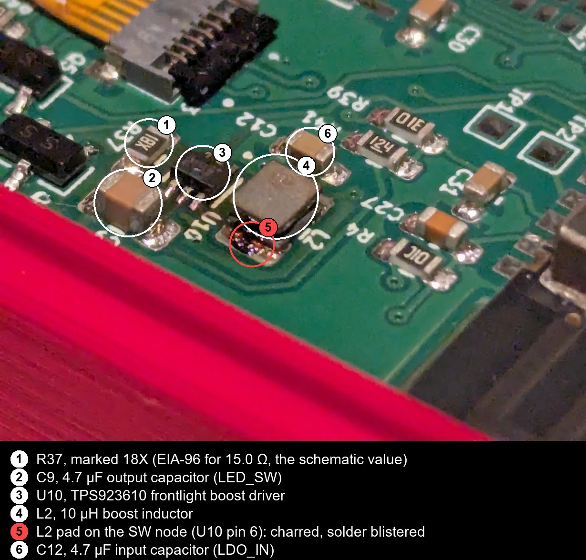
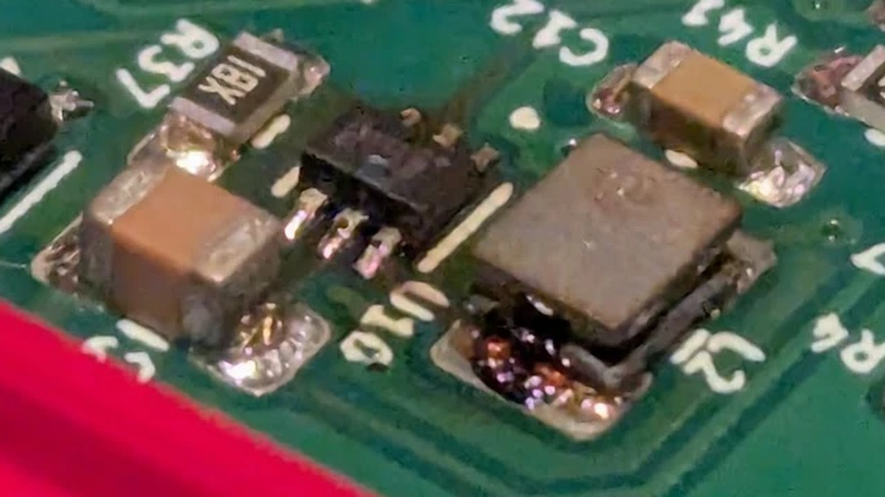
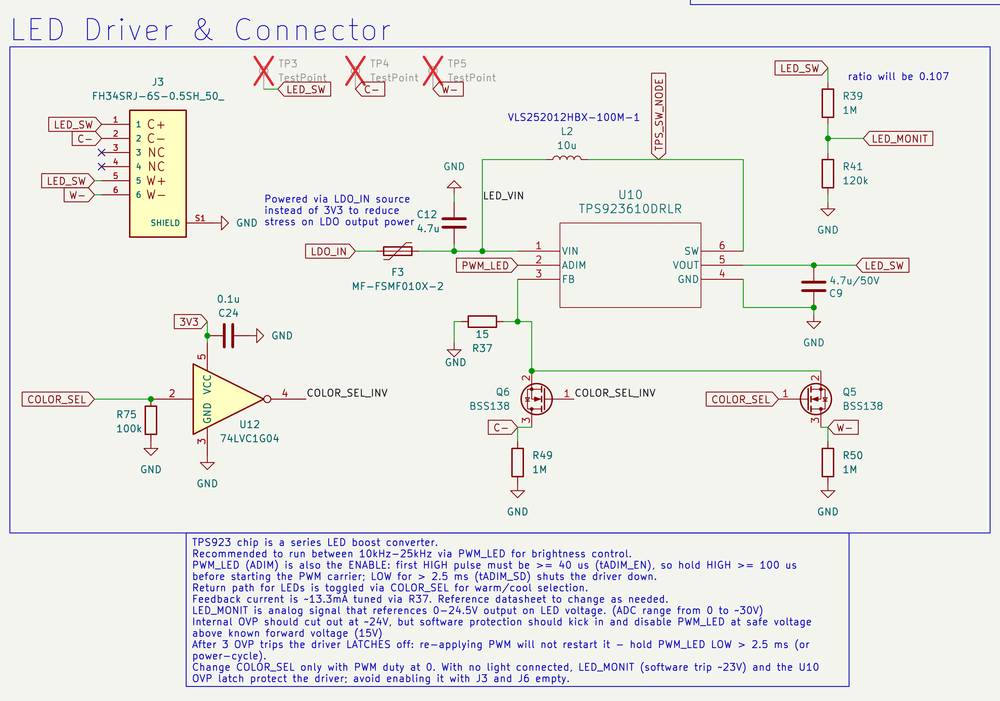

# Silkscreen — Board failures

Failures of Silkscreen boards, whether reported by an owner or found by the maintainer: what was
reported, what was measured afterwards, what the design files and datasheets say about it, and
whether the question is still open on the current revision (Rev 1.02). Cases are added as they are
reported and updated as boards are analysed. Each case is written so that someone who has not seen
the board can pick the analysis up where it stopped: see its open items and debugging steps.

Each statement in a case is one of four kinds, and the text says which:

- **Reported**: the account of the person who owned or flashed the board.
- **Measured**: a reading taken by the owner or on the bench.
- **Derived**: read off the schematic, the layout, a datasheet or the firmware.
- **Inferred**: reasoned from the above and not measured.

A conclusion is called *established* only when it rests on measured or derived facts alone.

| Case | Revision | Reported | Symptom | Status |
|---|---|---|---|---|
| [1](#case-1-rev-10-frontlight-boost-fault) | 1.0, assembled by JLCPCB | 2026-10-23 | Smoke and charring at `L2`, `U10` and `C9` on a USB power-up with the battery unplugged | Open: failed part found (`U10`'s low-side switch, shorted) and the board repaired; why the switch failed is not known |
| [2](#case-2-rev-10-hot-fault-near-the-usb-c-port-while-flashing) | 1.0, assembled by JLCPCB | 2026-10-26 (event about three weeks earlier) | Flash stopped, board no longer enumerated, area around the USB-C port very hot, 4.2 V at over 0.8 A, no battery | Open: board unpowered since, passive checks not yet done |

---

## Case 1: Rev 1.0, frontlight boost fault

| | |
|---|---|
| **Revision** | 1.0 (files published 2026-09-21), assembled by JLCPCB |
| **Reported** | 2026-10-23 |
| **Outcome** | Smoke and charring at `L2`, `U10` and `C9`, starting 30–60 s after a USB-C cable was connected with the battery unplugged. The cable was removed. No fire or injury was mentioned in the report. |
| **Board state** | With the maintainer since 2026-10-28. Analysed on the bench, `U10` replaced and `L2` refitted; the board powers up from USB and runs reflashed firmware (section 3.1). |
| **Status** | **Open.** The failed part is identified: `U10`'s internal low-side switch, shorted from `SW` to `GND`. Why it failed has not been established. |
| **Established** | `U10`'s low-side switch is shorted `SW` to `GND` at ≈7 Ω, the same in both polarities, measured on the removed part; its `VIN` pin is not shorted. Nothing else on the `LDO_IN` / SW-node network is shorted: `L2`, `C12`, `C4`, `U2`, `U3`, the `LDO_IN` trace and the board laminate are clear. The USB input (`F1`), the CC pull-downs, `C9` and the LED output net are intact. The ESP32 and its USB path work. The battery pack is neither latched nor over-discharged (3.26 V). |
| **Not established** | Why `U10`'s low-side switch failed (a weak or damaged part, or overstress in operation); why the 67 W charger did not power the board overnight. |

### 1. What the owner reported

All of this is **reported**. The owner is not named and the account is condensed.

1. **Evening.** The board was connected to a 67 W USB-C wall charger (Anker) with a USB-C to USB-C
   cable. A font download was started from the settings, over Wi-Fi. The font-download screen has no
   frontlight controls, so the frontlight was left on. The owner expected the board to charge and to
   time out once the download had finished.
2. **Next morning.** The board did not respond to the buttons. The screen still showed the
   font-download completion message. The red USB LED (`D2`) was not lit.
3. **Computer.** The board was moved from the charger to a computer. `D2` lit, the board booted and
   was usable for a while. The battery indicator read 0% and no charging was noticed.
4. **Daytime.** The board was unplugged and left.
5. **Evening.** The owner tried to reflash the board from the browser flasher. The flasher reported
   that the device did not authenticate ("or something to that effect").
6. **Teardown.** The case was opened and the battery unplugged. The flashing problem persisted.
7. **Failure.** With no battery fitted, a USB-C cable was connected once more to retry the flash.
   After about 30–60 seconds the board began to smoke around `L2`, `U10` and `C9`, and the cable was
   removed. Which source that last cable was plugged into (the computer or the wall charger) has not
   been confirmed.
8. **Afterwards.** The pack was measured at 3.26 V and the readings in section 3 were taken.

### 2. Photos

Taken by the owner after the failure, with the case open and the battery unplugged. The red object in
the foreground is not part of the board. The connector at the top, with a flex fitted, is `J3` (the
frontlight connector), judging by its position.

*Figure 1. The failed area, annotated. [Original photo](board-failures/case-01/overview.jpg).*

*Figure 2. `C9`, `U10` and `L2`, enlarged 2×.*

What the photo shows:

- `R37` reads 18X, the EIA-96 code for 15.0 Ω, which matches the schematic.
- `C9` and `C12` show no cracking or charring.
- `U10`'s body is dark and shows no cracking. Its pins carry dark flux residue.
- One `L2` pad is charred and its solder blistered; the body is discoloured on that side. The other
  pad is clean.
- **Inferred:** the charred pad is the one on the SW node (`U10` pin 6), not the one on `LDO_IN`.
  The identification comes from matching the photo to the layout, using the positions of `R37`,
  `C9`, `C12`, `R39` and `R41` as reference points.
- Only this part of the board is photographed. Both sides of the whole board and magnified views of
  the `U10` pins are to be added when the board is received.

### 3. Measurements after the failure

**Measured** by the owner with a multimeter, board unpowered, USB and battery unplugged, black probe
on a mounting-hole pad as ground unless stated. The "healthy" column is **derived** from the
schematic and datasheets, not read from a reference board; it is to be replaced with readings from
healthy boards (section 7).

| # | Measurement | Reading | Healthy board | What it shows |
|---|---|---|---|---|
| 1 | Battery pack at the connector, at rest | 3.26 V | 3.0–4.2 V | A nearly empty, undamaged cell. Not latched at 0 V and not over-discharged. |
| 2 | `F1` (1 A PPTC), end to end | ≈0 Ω | 0.1–0.3 Ω | Conducting. Meter resolution not recorded. |
| 3 | `F1`, each end to ground | Hundreds of kΩ to MΩ, varying | ≈0.4 MΩ (`R38` + `R51`) or higher | The USB input net is not shorted. |
| 4 | `L2`, end to end | ≈0 Ω | ≈0.5 Ω (DCR 0.45 Ω typ, 0.54 Ω max) | Conducting. A coarse meter shows 0 for both an intact `L2` and one bridged by char; resolution not recorded. |
| 5 | `L2`, each pad to ground | ≈6–7 Ω at the charred pad (the owner had to scratch through char to make contact), ≈7 Ω at the other | Hundreds of kΩ or more | A low-resistance path to ground on the `LDO_IN` / SW-node network. |
| 6 | `C9`, lower end to ground | ≈0 Ω | 0 Ω (ground) | Reference. |
| 7 | `C9`, upper end (`LED_SW`) to ground | Starts high, settles at ≈0.6 MΩ | ≈1.1 MΩ (`R39` + `R41`), lower with `U10`'s own pin loading in parallel | `LED_SW` is not shorted. |
| 8 | `C9`, capacitance | 4.7 µF | 4.7 µF nominal | `C9` is intact. |

#### 3.1 Bench analysis of the returned board

**Measured** by the maintainer on 2026-10-28 with a multimeter resolving 0.1 Ω and about 1 mV, board
unpowered unless stated, battery, SD card and frontlight flex removed. The healthy column was read
from a Rev 1.0 board of the same build where a value is given.

| # | Measurement | Failed board | Healthy board | What it shows |
|---|---|---|---|---|
| B1 | `LDO_IN` (`C12` pad 2) to `GND`, both polarities | ≈7 Ω both ways | MΩ or open | The fault. Resistive: no junction in the path. |
| B2 | `LDO_IN` at `C4` (beside `U2`) to `GND` | ≈7 Ω | | The same net, 56 mm away. |
| B3 | `C4` pad 1 to `C12` pad 2 | 0.0 Ω | 0.0 Ω | The `LDO_IN` trace and via are intact. |
| B4 | `L2`, end to end | 0.3 Ω | 0.3 Ω | `L2` is intact. |
| B5 | `U10` pin 3 (`FB`) to `GND` | 15 Ω | | `R37` and the FB pin are intact. |
| B6 | `U10` pin 2 (`ADIM`) to `GND` | 588 kΩ | 615 kΩ | `ADIM` and the ESP32's IO42 are intact. |
| B7 | `LED_SW` (`C9` pad 2) to `GND` | ≈1.2 MΩ | | `R39` + `R41`: the LED output is intact. The ≈0.6 MΩ of section 3 was probably read before it settled. |
| B8 | `3V3` to `GND`; diode mode, red on `3V3` | ≈5.5 kΩ; ≈0.4 V | ≈300 kΩ; ≈1.4 V | Not a 3V3 fault. The meter current runs through the body diode of `U3`'s pass element into the `LDO_IN` short (**inferred**). |
| B9 | `USB_VBUS` to `GND` | ≈266 kΩ | ≈300 kΩ | Not shorted. |
| B10 | `CC1` (`R3`) and `CC2` (`R2`) to `GND` | 5.1 kΩ each | 5.1 kΩ each | The CC pull-downs are intact, so they do not explain the 67 W charger (section 4.4). |

*Locating the fault with an injected current.* An AA cell in series with 100 Ω fed `LDO_IN` at
`C4` pad 1, returning at `C4` pad 2, so that the `LDO_IN` trace (≈0.11 Ω) and `L2` act as current
sensors. No IC on the net operates at that voltage.

| # | Measurement | Reading | What it shows |
|---|---|---|---|
| B11 | Across the 100 Ω; `C12` pad 2 to pad 1 | 1.4 V (14 mA); 100 mV | 7.1 Ω, matching B1. |
| B12 | Along the `LDO_IN` trace, `C4` pad 1 to `C12` pad 2 | ≈2 mV | ≈1.5 mV expected for the whole current: the fault is at the frontlight end. `C4`, `U2` and `U3` are cleared. |
| B13 | Across `L2`, pad 1 to pad 2 | ≈2 mV | 4–6 mV if all the current flowed through `L2`, 0 if none. Not decisive at this resolution; settled by B14. |

*Isolating parts.*

| # | Measurement | Reading | What it shows |
|---|---|---|---|
| B14 | `L2` removed: pad 2 land (SW node) to `GND`; pad 1 land (`LDO_IN`) to `GND` | ≈7 Ω; ≈7 kΩ one polarity, ≈5.4 kΩ the other, ≈0.5 V in diode mode | The short is on the SW node. The `LDO_IN` side shows junction behaviour only (see below). |
| B15 | `U10` removed, on the part: pin 6 (`SW`) to pin 4 (`GND`); pin 1 (`VIN`) to pin 4 | ≈7 Ω; open | `U10`'s low-side switch is shorted. `VIN` is not damaged. |

*Repair.* A new TPS923610DRLR was fitted and the original `L2` refitted. Powered from USB with no
battery, `3V3` was stable and nothing was shorted, so the SW node no longer reads low with the new
part: the laminate under `L2` and `U10` is not a conductive path. The firmware did not respond until
download mode was forced by holding BOOT; after a reflash the board runs. Frontlight operation and
temperature after the repair have not been recorded yet.

**What this establishes:**

- The fault element was `U10`'s internal low-side switch, shorted `SW` to `GND` at ≈7 Ω
  (**measured**). With USB attached, current ran `LDO_IN` → `L2` → `SW` → the shorted switch →
  `GND`, with nothing limiting it below `F1`'s 1 A hold (section 6.1, item 3). The charred `L2` pad
  is the SW-node end of that path (**inferred**).
- Nothing else on the `LDO_IN` / SW-node network was damaged (**measured**: B3–B6, B12, B14, B15 and
  the repair).
- The ESP32 and its USB path are intact (**measured**: the reflash). The browser flasher's failure
  in section 1, step 5, therefore points to a missing or corrupt application image rather than
  hardware: with no running application to answer it, the board is reachable only in download
  mode (**inferred**).
- Not established: why the low-side switch failed. The removed part has not been examined for an
  overstress, crack or ESD signature. The `LDO_IN` junction reading in B14 was not compared with a
  healthy board in the same polarity; `U10`'s `VIN` is ruled out (B15), which leaves the protection
  diodes of `U2` and `U3`, normal on a healthy board (**inferred**). The board works after the
  repair, so it is not consequential.

### 4. What the evidence shows

*Figure 3. The frontlight driver block (Rev 1.0 and Rev 1.02 are identical here).*

#### 4.1 Firmware behaviour that matters for the account

**Derived** from the firmware at the time of the report, with default settings:

- Below 3.4 V on battery, the boot-time check puts the board straight back to sleep without drawing
  the screen. With USB present the check is skipped.
- A normal timeout sleep draws the sleep image over the previous screen (default sleep timeout 10
  minutes).
- The frontlight comes back on at boot if it was on when power was lost (Restore Light on Wake is on
  by default).
- The battery indicator shows 0% for any pack below about 3.55 V. With USB present and the pack
  below 2.5 V it shows "No battery" instead of a percentage.

#### 4.2 The morning needs no hardware fault

- The pack is nearly empty and undamaged (3.26 V, measurement 1), so the 0% reading is expected, and
  so is a charge that cannot be seen on the display: 0% covers everything below about 3.55 V.
- `D2` was dark on the wall charger, so USB power was **not reaching the board** (reported). With no
  USB and a pack below 3.4 V, the boot-time check puts the board back to sleep each time a button
  wakes it, and the screen keeps its last image. That is "non-responsive" (**inferred**).
- The screen showed the download-completion message, not the sleep image. With default settings a
  normal timeout sleep would have replaced it, so the board did not finish a normal sleep: it lost
  power or reset and the boot-time check then slept it without redrawing (**inferred**).
- `D2` lit and the board booted on the computer because the boot-time check is skipped on USB
  power.
- The Wi-Fi, frontlight and charging load therefore ran for the length of the download and the sleep
  timeout, not for the night.

#### 4.3 The fault

- The USB input is intact: `F1` conducts and both its ends read high to ground (measurements 2, 3).
- The LED output is intact: `C9` reads 4.7 µF and ≈0.6 MΩ, and `LED_SW` is not shorted
  (measurements 7, 8).
- Both `L2` pads read 6–7 Ω to ground (measurement 5). They are joined by `L2` (≈0.5 Ω), so this is
  one network: `LDO_IN` and the SW node, which includes `U10`'s `VIN` and `SW` pins, `C12`, `L2`'s
  pads and any conductive char.
- At 5 V a 6–7 Ω path would draw about 0.75 A and dissipate 3–4 W in the fault element, if the cold
  reading held during the event and the source was stiff (**derived**; section 4.6 lists what this
  assumes). That is below `F1`'s 1 A hold current, so `F1` does not limit it. Whether the source
  does depends on the source: a USB 2.0 port is specified for 0.5 A, a PD wall charger is not
  limited. A fault that started at a higher resistance and fell as it heated would fit the 30–60 s
  before smoke (**inferred**).
- The charring is on `L2`'s SW-node pad, next to `U10` pin 6, and the readings (6–7 Ω there, 7 Ω at
  the other pad) are consistent with a short on the SW side. At this meter resolution they do not
  prove it (**inferred**). The bench analysis confirmed it: the short is `U10`'s low-side switch
  (section 3.1).
- The frontlight was probably on during those 30–60 s, because it is restored at boot by default
  (**derived**). The earlier boots on the computer would have restored it too.

#### 4.4 Not explained

- Why the 67 W charger did not power the board (`D2` dark). Charger, cable, a low-load shut-off and a
  compatibility problem with this board are all possible. A bench test is pending (section 7).
- Why `U10`'s low-side switch failed. The failed part is identified (section 3.1); the cause is not.
- Why the flasher could not authenticate the board. Largely answered in section 3.1: the ESP32 and
  its USB path are intact and the board reflashed in download mode, which points to a missing or
  corrupt application image (**inferred**). The CC pull-downs measure 5.1 kΩ, so they do not explain
  the charger either.
- Whether the final plug-in was on the computer or the wall charger, and whether `F1` tripped
  during the event. It is resettable, so its reading days later does not say (section 4.6).
- What happened between the last logged wake and the dead morning, and whose board the end of the
  battery log belongs to (section 4.5).

#### 4.5 The battery log

The firmware's battery log writes one row per completed sleep-and-wake cycle to
`/silkscreen-battery/battery.csv` on the SD card. The format is documented in
`docs/silkscreen/BATTERY-LOG.md` of the `crosspoint-reader` firmware repository, and
`scripts/silkscreen/battery_log_report.py` there decodes it (`python battery_log_report.py
battery.csv --out DIR`). The owner's copy (73 rows, four firmware builds) is not in this repository
because it is the owner's usage data; the maintainer holds it. Everything below was read from it
with that analyzer and a row-by-row decode.

**What the file can and cannot show** (derived from the format):

- A row is written only when a sleep ends in a verified wake. A session that ends in a reset or a
  flat pack leaves no row.
- Only the first segment has wall-clock time (2026-10-18T23:45Z to 2026-10-23T02:16:43Z). Later
  segments have time relative to the last power-up. The RTC keeps counting through a USB-reset
  flash and restarts at a power loss, which is how the segments were chained.
- The file is append-only on the card, so its order is time order unless the card was moved
  between boards.

**What it shows** (segment numbers are the analyzer's):

| Segment | Build | Content |
|---|---|---|
| 0 | CrossPoint 1.6.5, `45806d7a0` | 18–23 Oct. Normal use, 93% to 4.4% (3982 mV to 3550 mV). The only clock. |
| 1 | CrossPoint `45806d7a0` | Battery power-on at 3.55 V; a charger attached at the end. |
| 2 | CrossInk 1.6.1, `793c2fd8f`, flashed over USB | 4.5 h on battery, 3.59 V to 3.49 V. Row 6 is the only long radio session: 12.0 min of Wi-Fi with the light on at 2% for 12.8 min and no USB, ending at 3494.7 mV; then a 1.68 h sleep and a USB wake. |
| 3–5 | CrossInk `c263b30b1` | Power-on; a USB wake at 3.46 V; the only low-battery cutoff row (entry 2879.9 mV under load, USB present for the first 7.1 s only, light on); two identical power-on boots on USB with the screen reading 0%. |
| 6 | CrossPoint `45806d7a0` | Brown-out reset at a battery reconnect, screen at 4.2%. |
| 7 | CrossPoint `45806d7a0` | 2.7 h on USB, 3553 mV to 4150 mV, charge complete. |
| 8–9 | CrossPoint `45806d7a0` | Power-ons at 92%. |
| 10–11 | CrossInk `e18799c84` | USB-reset flash at 97%; power-on at 92%; 9.8 h on battery to 4032 mV. The last row is an 8.53 h sleep (4032.2 mV in, 4035.0 mV out), no USB, light off, with 2.1 min of radio before it. |

After the first segment there are 11 orphan boots: 7 power-ups, 2 USB-reset flashes, 1 brown-out and
1 lost record. There are no panics or watchdog resets.

**Derived:**

- **Drain.** Over 3.5 days of normal use the pack fell from 58.6% to 5.6%, 19% a day, or about
  96 mAh a day at the analyzer's assumed 500 mAh (the real capacity is not known). The board was
  awake 6.3 h and asleep 84.9 h in that window, which puts the awake average at about 33–42 mA.
  Sleep draw can only be bounded, at no more than 0.66 mA.
- **The pack was already nearly empty.** At the last timestamped row (2026-10-23T02:16Z, after a
  7.4 min light-on session) it read 3550 mV, 4.4%. The screen showed 5% or less from there until the
  segment-7 charge, apart from readings inflated by USB, and no sustained charge appears before it.
  A flat pack the morning after a Wi-Fi and light session therefore needs no fault (section 4.2).
- **No latent short.** `LDO_IN` is fed from the cell through `U2` whenever USB is absent, so a
  6–7 Ω path would pull about 0.6 A and empty the pack within an hour. The pack came through sleeps
  of 13.3, 9.8, 8.9 and 8.5 h. If the whole file is this board, the path was created by the event,
  not before it.
- USB was attached during sleep onto packs at 3.55 V or lower four times (segments 1, 2, 4 and 7)
  without harm, and one full charge ran to charge-complete.
- **By design the board cannot drain overnight.** The font-download result screen hands over to the
  10 min sleep timeout (`radioOffWhenIdle` is set for this board) and a 15 min awake ceiling backs
  it up on battery. A completion screen still on the display in the morning therefore means a
  reset, brown-out or low-battery cutoff, not a slow drain.

**Not resolved:**

- No shutdown time can be recovered. The file ends on a normal wake at 4035 mV (87%), so the final
  session is unlogged: a non-logging firmware flashed with the browser flasher, the card removed,
  or a session that never slept.
- The 3.26 V measured after the failure fits the near-empty pack of segments 1 to 6 and does not
  fit the 4.03 V of the last row. Either the end of the file is not this board's last state (the
  card was in another board, or the pack was moved), or something took the pack from 87% to 3.26 V
  after the last row, which would be a finding in itself.
- Questions for the owner: when the file was copied and whether the card was ever in another board;
  which firmware ran the font download and whether a release build was flashed with the browser
  flasher (release builds do not log); how many days passed between the dead morning and the smoke;
  how often the battery was unplugged.

#### 4.6 What the 6–7 Ω reading assumes

**Measured:** a cold, hand-held DC reading taken after the event, with the meter's test voltage
under about a volt, through scratched char, resolution not recorded (section 3). **Derived from
it:** the current (about 0.75 A), the power (3–4 W) and, with the 30–60 s, the energy before smoke
(roughly 100–200 J). The derivation assumes:

- **The same resistance during the event.** Char is non-linear and changes with temperature, and
  the 6–7 Ω may be the aftermath of the fault rather than the initiating fault.
- **A stiff 5 V source.** A USB 2.0 port is specified for 0.5 A and may limit near it (about 1.6 W
  in 6.5 Ω); a 3 A PD charger would not. The source of the final plug-in is unconfirmed.
- **Steady DC.** A switching fault with the light running could look different.
- **One resistive path.**

Across 3–20 Ω the fault power at 5 V would be about 6 W down to 1.2 W (with 0.56 Ω of source and
trace). The data support "hundreds of mA and a few watts", not the exact figures.

`F1` reading normally days later does not show that it never tripped. It is a resettable PTC (hold
1 A, trip 1.95 A at 23 °C); a fault that fell below about 2 Ω during the event could have tripped
it, and it would have reset once the cable was out.

**The path, with the battery unplugged:** `J1` → `F1` → `USB_VBUS` → `U2` (power mux, battery side
empty) → `LDO_IN` → a 56 mm run of 0.25 mm front-copper trace (about 0.11 Ω) → via at (52.0, 117.8)
→ `L2` pad 1, `C12` and `U10` pin 1 → `L2` (0.45 Ω; at DC a plain wire, so the light need not be
on) → SW node (`L2` pad 2, `U10` pin 6) → the fault → ground. The 3V3 regulator `U3` hangs off
`LDO_IN` in parallel and is not in the fault path. About 0.56 Ω of `F1`, `U2` and trace is in series
with the fault.

**Firming it up:** on the returned board, drive 1 V, 3 V and 5 V from a supply limited to 0.3 A
between `L2` pad 1 and ground, cold and again after a minute, and compare V/I with 6–7 Ω; then
isolate the parts (section 7).

### 5. Considered and judged unlikely

| Hypothesis | Why it is judged unlikely |
|---|---|
| The overnight load (Wi-Fi download, frontlight, charging) damaged the board | The load ran for the download, not the night (4.2). It was well inside every rating on this branch: the light is about 0.2 W ([HARDWARE.md §7](HARDWARE.md#7-frontlight-driver)), and the system stack is analysed in [DESIGN_REVIEW.md §3](../DESIGN_REVIEW.md#3-usb-input-charging-mux-and-regulator). The pack shows no drain. |
| A leak on the LED output (`C9`, `D3`) ran away | `C9` reads 4.7 µF and ≈0.6 MΩ; `LED_SW` is not shorted. |
| The pack was drained by a leak and its protection latched | The pack reads 3.26 V. |
| The charge-enable limitation for latched packs ("Fix 4") | The pack is not latched, and the gate is open at 3.26 V ([DESIGN_REVIEW.md §4](../DESIGN_REVIEW.md#4-battery-protection-a-newly-identified-fault-path)). |
| USB hot-plug ringing | A USB-C source ramps VBUS after attach and does not overshoot; with no battery `U2` soft-starts, which is the gentlest case for `LDO_IN`; ringing lasts microseconds and the smoke began 30–60 s later; the hot-plug study keeps `LDO_IN` at or below about 5.6 V against `U10`'s 6 V limit ([HARDWARE.md §3.1](HARDWARE.md#31-usb-c-input--protection)). |
| `L2` was overloaded (saturation or rating) | At about 0.75 A `L2` is inside its 0.85 A rated current. The heat was in the fault element. |
| A battery-less cold start (in-rush, with the light restored at boot) caused the damage | A behavioural model from the netlist and datasheets, not SPICE: a cold attach draws 0.5–0.7 A for about 1 ms; the `L2` → `U10` body diode → `C9` path sees about 18 mA, against about 0.9 A for a plug-in onto a low cell and 1.6 A for a battery hot-plug; the light start about 3.5 s after attach draws about 0.95 A (1.35 A if a display refresh coincides); everything at once peaks at 1.5 A for 0.5 ms. All of it is inside the ratings and lasts milliseconds, against 30–60 s to smoke. Functional flag only: through a poor cable (0.8 Ω) or a 4.75 V source, `VBUS` can dip to about 4.2 V when the light starts, near `U2`'s 4.0 V switchover, so a battery-less board can brown out and reboot. |

### 6. Design scrutiny

#### 6.1 Rev 1.0, as built

Reference data: [TPS923610](https://www.ti.com/lit/ds/symlink/tps923610.pdf) (`VIN` absolute maximum
6 V, switch current limit 1.6 / 1.8 / 2.1 A min / typ / max, `SW` and `VOUT` 32 V); `L2` is the TDK
[VLS252012HBX-100M-1](https://datasheet.lcsc.com/datasheet/pdf/de422f385540fd5f1bb91cb97a2c323c.pdf?productCode=C88532)
(DCR 0.45 Ω typ / 0.54 Ω max, rated current 0.85 A for a 40 K temperature rise, saturation current
1.00 A, 1.30 A typ);
the 4.7 µH it replaced was the TDK
[VLS252010HBX-4R7M-1](https://datasheet.lcsc.com/datasheet/pdf/a25507d4dccbddd5db28734791dab924.pdf?productCode=C88528)
(DCR 0.208 Ω typ, rated 1.09 A).

| # | Aspect | Finding | Rev 1.0 | Rev 1.02 |
|---|---|---|---|---|
| 1 | Ratings on the boost input | `LDO_IN` is 5.5 V at most from USB and 4.2 V at most from the cell, against `U10`'s 6 V limit. The upstream clamp (`CR1`) starts at 7.2 V. No condition that exceeds a rating on this branch was found; the margin to 6 V is thin (≈0.5 V) and was accepted ([DESIGN_REVIEW.md §3](../DESIGN_REVIEW.md#3-usb-input-charging-mux-and-regulator)). | Not implicated; margin thin | Unchanged |
| 2 | USB hot-plug ringing | No `R84`. See section 5. | Judged unlikely here | `R84` fitted (worst stack-up 5.6 V on `U2` `VIN1`); closes the USB-A exposure; not relevant to this case |
| 3 | Containment on the boost branch | `F1` holds 1 A, trips at 1.95 A (0.65 A hold at 60 °C) and protects the whole board, whose illustrative worst-case load is about 650 mA. A 6–7 Ω fault draws about 0.75 A and dissipates 3–4 W: invisible to `F1`, and to a PD charger. The path `LDO_IN` → `L2` → `U10` body diode exists even when the driver is off ([HARDWARE.md §7](HARDWARE.md#7-frontlight-driver)). Nothing on the branch limits current. | **Design gap.** Sets the severity, not the cause. | Unchanged. **Open.** |
| 4 | `L2` selection (10 µH) | For a hard short the 10 µH heats about 1.6× as much as the 4.7 µH it replaced, and its solder reaches melting temperature at about 1.9–2.2 A instead of 2.4–2.8 A (estimate from TDK's temperature-rise rating). At about 0.75 A it is inside its rating. | Not the cause here; matters for hard shorts | Unchanged |
| 5 | Plug-in and battery hot-plug surge | A 2 V step on `LDO_IN` with the light off pushes about 0.9–1 A through `L2`, `U10`'s body diode and `C9` (simulation); a battery hot-plug about 2.5 A. Never measured ([DESIGN_REVIEW.md §8](../DESIGN_REVIEW.md#8-frontlight-sample-mapping-current-and-dynamic-behavior)). | Cannot be excluded | Unchanged (`R84` does not affect the battery path) |
| 6 | Blend mode | Colour select at 10 kHz, default warmth 50%. Documented as unvalidated; `L2` saturates (about 1.0 A) below `U10`'s 1.6–2.1 A limit ([HARDWARE.md §7](HARDWARE.md#7-frontlight-driver)). | Cannot be excluded | Unchanged |
| 7 | Charging and low-battery behaviour | Not implicated in the fault. It explains the dead-looking morning: a low pack with no USB gives no message. | Usability gap | Charge-enable gate now fed from `USB_VBUS`; same behaviour |
| 8 | USB-C source compatibility | `D2` was dark on a 67 W PD charger over C–C and lit on a computer. No design cause identified. | Open | Same CC network (`J1` is now an SMD receptacle). Open. |
| 9 | Assembly, parts, handling | JLCPCB-assembled. `U10` is a 0.5 mm-pitch SOT-563 with `SW`, `VOUT` and `GND` on adjacent pins, and is often out of stock at JLC ([BOM.md](../fabrication/BOM.md)); how this board's `U10` was sourced is to be confirmed. The owner opened the case before the failure (ESD, flexing). | `U10` confirmed as the failed part (section 3.1); its source and the failure mechanism are open | Same parts and process. Open. |

#### 6.2 Rev 1.02 (current)

A footprint and pad-net comparison of the Rev 1.0 files (the repository as of 2026-09-21, commit
`92b3e74`) against Rev 1.02 shows these changes: `R84` added (hot-plug damper in `C2`'s ground leg); `J1` changed from the through-hole
`USB4085` to a 12-pad SMD receptacle; `R79`–`R82` values changed; the charge-enable gate (`Q2`, `R81`)
fed from `USB_VBUS` instead of 3V3; assembly-offset fields; and ground-stitching vias below the cut
line (see the "Rev 1.02" note at the top of [HARDWARE.md](HARDWARE.md)).

Rev 1.02 has not been fabricated, so its status here comes from the design files and the analysis
above, not from field data.

The frontlight boost branch is **identical**: `U10`, `L2`, `C9`, `C12`, `D3`, `R37`, `R39`, `R41`,
`C31`, `Q5` and `Q6` have the same values and connections. Every open item above that concerns that
branch (3, 5, 6, 9) is therefore open on Rev 1.02 as well. Item 2 is closed for USB-A sources by
`R84` and was not implicated here. Item 7's cause is unchanged. Item 8 is open until the charger is
tested.

#### 6.3 Verdict as of the last update

- **Failed part: identified.** `U10`'s internal low-side switch shorted `SW` to `GND` (section 3.1).
  Nothing else on the branch was damaged.
- **Why it failed: not identified.** A weak or damaged part (a defect, ESD while the case was open,
  a bad lot) and overstress in operation both remain. On the evidence so far the first is more
  likely: the branch runs inside its ratings, the fault appeared at the first power-up after the
  board had been opened and handled, and `U10` has an open sourcing question. The design question
  that would point at overstress is `L2` saturating below `U10`'s switch current limit (section
  6.1, item 6). This is a lean, not a finding.
- **Severity: a design weakness.** One defect on this branch was able to run to smoke, because
  nothing limits current below `F1`'s 1 A hold (item 3). This applies to Rev 1.0 and Rev 1.02
  alike.
- **What would change the verdict:**
  - Other boards show the same signature (low `LDO_IN` to ground resistance, or extra idle draw):
    systematic, so part, process or design.
  - The failed part shows electrical overstress rather than a crack or an ESD signature, or the
    scope shows the plug-in surge or blend-mode stress above a rating: design.
  - The 67 W charger repeatedly fails to power a healthy board: input circuit or compatibility.

#### 6.4 Mitigation options studied

**Adopted for the next revision (decided 2026-11-02):** the thermally placed PTC below, plus PTCs on the touch, `J6`
pin 7 and e-paper branches and a `DW01A` sense resistor. See [NEXT_REVISION.md](NEXT_REVISION.md).

**Inline PTC on the boost feed** (studied 2026-10-26). A resettable fuse in series with the feed to
`L2`, `C12` and `U10` `VIN`: no GPIO, no standby current, about $0.16 of parts. It would contain a
hard fault on that branch. It would not prevent the initiating defect.

*Method.* The average time-current curves of the Littelfuse
[0603L series](https://littelfuse.com/%7E/media/electronics/datasheets/resettable_ptcs/littelfuse_ptc_0603l_datasheet.pdf.pdf)
were digitised from the datasheet and its hold-current rerating table applied; a resistive fault was
placed after the PTC with 0.56 Ω of source and trace; start-up currents were read from Figures 8-4
and 8-5 of the [TPS923610 datasheet](https://www.ti.com/lit/ds/symlink/tps923610.pdf). Littelfuse
gives its curves as guidance only, and the models are bounded estimates, not SPICE.

*Against the field fault* (6.5 Ω at 5 V, typical PTC resistance, 20 °C; unprotected, the fault
dissipates 3.3 W: 98 J in 30 s, 196 J in 60 s):

| Part | Trip time | Energy before the trip | Afterwards |
|---|---|---|---|
| 0603L010 | 0.2 s | 0.4 J | 0.1 W in the fault, 0.5 W in the PTC |
| 0603L020 | 0.34 s | 0.8 J | the same |
| 0603L025 | 0.58 s | 1.4 J | the same |

*Where it does not help.* Between hold and trip current a trip is not guaranteed. A fault is sure to
trip the part when its resistance is below about the following (at 5 V and 20 °C, and on the cell
at 3.7 V):

| Part | Sure to trip below, 5 V | Sure to trip below, 3.7 V cell | Most an untripped fault can dissipate |
|---|---|---|---|
| 0603L010 | 10–15 Ω | 6–11 Ω | 1.4 W |
| 0603L020 | 6–9 Ω | 3–6 Ω | 2.2 W |
| 0603L025 | 5.5–8 Ω | 3–6 Ω | 2.4 W |

At 10 Ω the L025 takes 65 s to trip (117 J), the L020 9 s (16 J) and the L010 0.7 s; at 13 Ω the L020
and L025 do not trip within 100 s. A hot ambient widens the window (the L020 at 60 °C trips up to
13–16 Ω). Slow leaks of 15–30 Ω (0.8–1.2 W) stay uncovered.

*Normal operation and start-up.* The boost draws about 69 mA at today's 100% (3.4 V cell), 14 mA at
a 2.3 mA top level and 3 mA at the night level. At 60 °C the hold current is 60 mA for the L010 and
120 mA for the L020, so the L010 would nuisance-trip at today's 100% in a hot case. In steady state
the PTC lowers the boost input by 0.05–0.08 V at the lower top level and 0.24–0.41 V at today's
100%; the driver regulates LED current from a 2.5 V input, so brightness, colour balance and
flicker do not change. The turn-on is the risk. TI's Figure 8-4 (100% duty) shows a 0.7 A inductor
peak for 0.4 ms and Figure 8-5 (10% duty) a 3 ms ramp to about 0.17 A. The chip input must stay
above the 2.17 V worst-case falling UVLO threshold, which at a 3.4 V cell allows a PTC resistance of
6.5 Ω at 0.17 A, 4.2 Ω at 0.25 A, 2.4 Ω at 0.4 A and 1.2 Ω at 0.7 A. A lower top level, or a
firmware turn-on ramp that starts at 10% duty or less and then raises it (the soft-start ramp scales
with the duty), keeps the start-up in the first two cases. The datasheet does not say whether the
chip re-arms its enable after a UVLO event, so a sagging start-up may leave the light off.

*Side effects.* A series PTC cuts the USB plug-in peak through `L2` from 0.84 A to 0.60 A at 1 Ω
and 0.46 A at 2 Ω, and the cell hot-plug peak from 1.54 A to 1.13 A and 0.87 A, for 5–40 µJ in the
PTC. A tripped PTC still passes about 120 mA, so a persistent fault drains a cell in about 4 h, even
asleep, and leaves a 100–125 °C spot.

*Parts* (stock and prices read 2026-10-26; all three are JLC Extended parts):

| Part | Hold / trip, max voltage | Resistance after reflow | LCSC | DigiKey |
|---|---|---|---|---|
| 0603L010YR | 0.10 / 0.30 A, 15 V | 0.9–6.0 Ω | C207010, 12.2k, $0.156 at 5 | F2900CT-ND, 109k, $1.43 |
| 0603L020YR | 0.20 / 0.50 A, 9 V | 0.55–3.5 Ω | C207011, 3.65k | F2901CT-ND, 50.7k, $1.43 |
| 0603L025YR | 0.25 / 0.55 A, 9 V | 0.5–3.0 Ω | C207012, 2.0k | n/a |

The Bourns MF-FSMF010X-2 and MF-FSMF020X-2 are DigiKey's direct substitutes.

*Layout* (Rev 1.02 files). All SMD parts are on the back copper (the front carries only the logo,
`H5` and three test points), so the PTC has to go on the back too. The boost is fed by one 0.25 mm
front-copper run of 56.5 mm (about 0.11 Ω) from the via at (83.2, 86.1) beside `U2` and `C4` to the
via at (52.0, 117.8). The nearest free 0603 land at 0.2 mm clearance is about (48.4, 116.3), north-west
of `L2` and 3.9 mm from that via; reaching it needs a two-via hop across the `LED_SW` run at
y = 117.1, or a move of `R39` and `R41`.

*Testing without spare boards.* Trip and heat behaviour can be checked on bare parts: a PTC,
resistors of 6.8, 10, 13 and 16 Ω and a USB supply or a Li-ion cell, with a USB power meter showing
the current collapse, then a 60 °C soak. The start-up check belongs on the first article of the next
spin, with the PTC position fitted first with 0603 stand-ins (0, 2.2 and 3.3 Ω); a 0 Ω resistor
restores Rev 1.02 behaviour.

*Lean, not a decision.* The 0603L020 with a firmware turn-on ramp closes the start-up risk on paper
at its worst-case 3.5 Ω (chip input about 2.7 V at 0.17 A and 2.4 V at 0.25 A, with a 3.4 V cell).
The 0603L010 protects a wider window but needs the lower top level and a bench start-up check.

*Against the measured short* (added 2026-10-29). Section 3.1 found a ≈7 Ω short. A PTC is sure to
trip on it only if V / (7 Ω + 0.56 Ω + its own post-reflow resistance) reaches its trip current. For
the 0603L010 (0.30 A, up to 6.0 Ω) that needs 4.07 V; for the 0603L020 it is not guaranteed even on
USB. Across the polymer parts checked (Littelfuse 0603L, Bourns MF-FSMF, -PSMF, -NSMF, -MSMF, -USMF)
resistance × trip current² is 0.45–0.94 W, and the parts nearest the best trip current for this
fault (about 0.27 A) sit at 0.53–0.55 W, which puts the best possible guarantee for 7 Ω at about
4.0 V; the best part found guarantees it from 4.07 V. No PTC covers the lower half of the cell's
range by that current-based arithmetic, which the electro-thermal model below shows to be too
pessimistic. The Bourns MF-NSMF012/48X (1206)
matches the 0603L010's coverage and holds 69 mA up to about 70 °C instead of 50 °C. Mounting a PTC
on copper shared with `L2`/`U10` lowers its trip current in a fault, but that is not a guarantee.

**Latching electronic fuse** (studied 2026-10-29, [audit-2026-10-29/BOOST_EFUSE.md](audit-2026-10-29/BOOST_EFUSE.md)).
A discrete fuse in the boost feed, no GPIO and no BGA: a 2.7 Ω sense resistor, the AO3401A already on
the BOM as the switch, three SOT-23 transistors forming a sense stage and a latch, and a 470 nF delay
capacitor; 14 parts. In 2 451 LTspice runs (generic models, behavioural `U10`) it trips on the 7 Ω
`SW` short from a 3.0 V cell to USB at −20 to 60 °C in 5–14 ms with at most about 11 mJ in the short,
also on `C12` and `LED_SW` shorts, and did not trip on any power-up, USB plug-in or unplug, or
modelled light start. A short it misses dissipates at most 0.47–0.90 W at 25 °C. It costs 67–243 mV
of drop and about 1 nA of standby current; after a trip it stays latched until battery and USB are
removed. Open before adopting: the light's real start-up current, a pulse-rated sense resistor, and
board space. Fourteen parts is too many for the board, so it is kept as the reference design only.

**4-part current limiter** (studied 2026-10-29, [audit-2026-10-29/BOOST_LIMITER.md](audit-2026-10-29/BOOST_LIMITER.md)).
A 2.7 Ω sense resistor, the AO3401A, one MMBT3906 and a 1 MΩ gate pull-down: the transistor turns on
at about 0.5 V across the resistor and holds the branch at 0.17–0.20 A (25 °C), at any supply
voltage. In 774 LTspice runs it holds the 7 Ω `SW` short to 0.23–0.25 W in the short from a 3.0 V cell
to USB, keeps `LDO_IN` up, draws no standby current and cannot trip by mistake. It does not switch
off: a held short drains a 500 mAh cell in about 2 h and heats the AO3401A by up to 0.56 W (case 1
short on USB) or 0.81 W (dead short on USB), so the FET needs copper and the transistor should sit
against it. If the light's start-up current is above the limit, `U10` stutters through UVLO at turn-on.
Open before adopting: that start-up current, and the FET's temperature on the board's copper.
Four parts was still more than wanted.

**Thermally placed PTC** (studied 2026-10-29, [audit-2026-10-29/PTC_THERMAL.md](audit-2026-10-29/PTC_THERMAL.md)).
One Bourns MF-FSMF010X-2 (0603, 0.10 A hold / 0.30 A trip; JLC `C210355`, DigiKey
118-MF-FSMF010X-2CT-ND; DigiKey stock unconfirmed on 2026-11-02, alternate MF-PSMF010X-2 0805 stocked at
both, see [PROTECTION_FOLLOWUP.md](audit-2026-10-29/PROTECTION_FOLLOWUP.md)) between `LDO_IN` and a new net `LED_VIN` carrying `C12`,
`L2` pin 1 and `U10` `VIN`, placed close to `U10` on thermally light pads. An electro-thermal model,
with the PTC fitted to its datasheet and a swept generic board, shows the current-based arithmetic
above was too pessimistic: a PTC trips on its own I²R heating, and the high-resistance parts that pass
the least current heat the most. With the case 1 short (7 Ω inside `U10`) at 25 °C it trips at every
supply from a 3.0 V cell to USB in 0.9–5.1 s, leaving 0.02–0.09 W in the short (against 1.0–2.75 W)
and `U10` at 88 °C or less. Limits: at −20 °C it does not trip from a 3.0 V cell; 10 Ω shorts need
3.4 V and 15 Ω shorts 4.2 V at 25 °C; tripped, it sits at 100–112 °C passing 50–115 mA. Keeping the
PTC thermally isolated matters more than coupling it to `U10`. At 100 % duty a 6 Ω part can drop `U10`
into UVLO from a cell of 3.7 V or less; the 50 % cap is fine. *Lean, not a decision:* this PTC, after
the bench test in that study.

### 7. Open items

- **Remaining work on the returned board.** Record frontlight operation after the repair (each
  level, both colours and blend, and `U10`'s temperature after a soak). Photograph the removed
  `U10`'s marking and both faces, and compare the marking with a `U10` from a healthy board of the
  same build. Optionally have it decapsulated: widespread melting over the low-side switch points to
  overstress, a localised pinhole at a pin to ESD or a defect. Compare `LDO_IN` to ground in both
  polarities and in diode mode with a healthy board (section 3.1, B14).
- **Source of `U10`.** Date code and lot, and how it reached the JLC build (stock, pre-order, global
  sourcing or consignment).
- **Screening of other boards.** `LDO_IN` to ground should be 100 kΩ or more (in circuit this also
  covers the SW node, joined to it through `L2`) and `LED_SW` to ground about 1.1–1.2 MΩ; record idle current at 5 V from a current-limited supply with the light off and
  on; soak the light for an hour or two in blend and in a single colour with a thermal camera.
- **Scope measurements.** The plug-in and battery hot-plug surge (`L2` current, `LED_SW`) and the SW
  node in blend mode, which are the two unmeasured items in section 6.1.
- **Charger compatibility.** Connect a board to a 67 W PD wall charger over C–C and watch `D2` at
  plug-in and again after the board sleeps.
- **From the owner.** The source of the final plug-in; whether the frontlight or screen was on during
  the 30–60 s; any smell or discolouration when the case was first opened; and the questions at the
  end of section 4.5 (when the
  battery log was copied, whether the card was in another board, which firmware ran the font
  download).
- **Boost-branch current limit: decided 2026-11-02** ([NEXT_REVISION.md](NEXT_REVISION.md)). The
  thermally placed MF-FSMF010X-2 PTC is adopted (section 6.4, [PTC_THERMAL.md](audit-2026-10-29/PTC_THERMAL.md)).
  Before ordering, run that study's bench test: a 6.8 Ω stand-in for `U10`'s short at 3.0–5.0 V, and the light at
  100 % for 30 minutes from 3.0 V. The 4-part limiter ([BOOST_LIMITER.md](audit-2026-10-29/BOOST_LIMITER.md)) is the
  fallback. Also: a low-battery message before the board sleeps; a documentation note that a low pack with no USB
  looks like a dead board.
- **Board-wide fault containment: decided 2026-11-02** ([NEXT_REVISION.md](NEXT_REVISION.md);
  [DURABILITY_AUDIT.md](audit-2026-10-29/DURABILITY_AUDIT.md), follow-up
  [PROTECTION_FOLLOWUP.md](audit-2026-10-29/PROTECTION_FOLLOWUP.md)).
  - **Battery path:** the battery-fed rails have the largest unprotected window, shorts of about 2.6 Ω and up at up to about 5 W. A PTC at `R27` does not work there. A 68 mΩ `DW01A` sense resistor plus `C34` raised to 0.1 µF cuts that to 3.0 W.
  - **3V3 branches:** the 3V3 rail relies on `U3`'s current limit (case 2). The frontlight's PTC part goes in place of `R42` (touch supply), in series with `J6` pin 7 (20 mA budget), and on the e-paper feed, which `J2` shares.
  - **microSD:** firmware keeps the card off after a brownout during SD use, since no PTC fits.
  - **Charging:** `R6` = 10 kΩ halves the charger's heat.
  - **Measurements:** 13 front-side test pads. Measure the coincident battery peak before committing to the sense resistor.

### 8. What to send with a failure report

- Photos of both sides of the board, in daylight, with close-ups of anything burnt.
- The revision on the title block, and who assembled the board.
- The charger and cable used, and whether `D2` was lit.
- What was on the screen and whether the frontlight was on.
- The pack voltage at the connector, measured at rest.
- With the board unpowered and USB and battery unplugged, using a mounting-hole pad as ground:
  `F1` end to end and each end to ground; `L2` end to end and each pad to ground; `C9` capacitance
  and each end to ground. Note the meter's resolution.
- If the board ran a battery-log firmware build: a copy of `/silkscreen-battery/battery.csv` from
  the SD card (section 4.5).

If a board smokes or smells hot, unplug USB and the battery at once. Do not power it again from a
stiff source; if it must be powered for diagnosis, use a bench supply set to 5 V and no more than
100 mA.

---

### Update log

- **2026-10-24.** Case 1 opened from the owner's report, the photo and the first multimeter readings.
  The board has not yet been received.
- **2026-10-24.** `L2`'s rated current corrected in HARDWARE.md section 7 and the BOM notes: 0.85 A
  (set by the 40 K temperature rise), where HARDWARE.md had quoted the 1.0 A saturation current as
  its rating.
- **2026-10-26.** The owner's battery log read (section 4.5); the assumptions behind the 6–7 Ω
  reading written down (section 4.6); the inline PTC studied (section 6.4); a cold-start in-rush
  row added to section 5.
- **2026-10-28.** Section 4.3 no longer says 0.75 A is below any USB source's limit (a USB 2.0 port
  is specified for 0.5 A). Case 2 opened below.
- **2026-10-28.** The board was received and analysed on the bench (section 3.1): `U10`'s low-side
  switch is shorted `SW` to `GND` at ≈7 Ω, and nothing else on the boost input is damaged. `U10`
  was replaced and `L2` refitted; reflashed in download mode, the board runs. Status, the verdict
  (section 6.3) and the open items (section 7) updated.
- **2026-10-29.** Section 6.4: PTCs checked against the measured 7 Ω short (none guarantees a trip
  below about 4.0 V), and a latching electronic fuse designed and simulated
  ([audit-2026-10-29/BOOST_EFUSE.md](audit-2026-10-29/BOOST_EFUSE.md)). At 14 parts it was too large;
  a 4-part current limiter was simulated next ([BOOST_LIMITER.md](audit-2026-10-29/BOOST_LIMITER.md)),
  then a single thermally placed PTC with an electro-thermal model
  ([PTC_THERMAL.md](audit-2026-10-29/PTC_THERMAL.md)), which is now the lean. A board-wide durability and
  fault-containment audit followed ([DURABILITY_AUDIT.md](audit-2026-10-29/DURABILITY_AUDIT.md)).
- **2026-11-02.** Protection follow-up ([PROTECTION_FOLLOWUP.md](audit-2026-10-29/PROTECTION_FOLLOWUP.md)):
  - **Cheap wins:** the touch and `J6` PTCs were simulated and priced.
  - **Battery path:** a PTC was rejected in favour of a `DW01A` sense resistor.
  - **microSD:** no PTC fits; firmware keeps the card off instead.
  - **Charging:** `R6` = 10 kΩ recommended.
  - **Diagnosis:** probe nets and test pads listed.
  - **Sourcing:** JLC stock figures corrected (MF-FSMF010X-2 has 26 658, not about 70 700). DigiKey stock for it is unconfirmed; MF-PSMF010X-2 is the alternate stocked at both.
  - **Decided for the next revision:** the frontlight, touch, `J6` pin 7 and e-paper PTCs, with `J2` sharing the e-paper PTC; the 68 mΩ `DW01A` sense resistor with `C34` raised to 0.1 µF; `R6` = 10 kΩ; and 13 front-side test pads clear of the artwork (follow-up sections 7–8).

---

## Case 2: Rev 1.0, hot fault near the USB-C port while flashing

| | |
|---|---|
| **Revision** | 1.0 (files published 2026-09-21), assembled by JLCPCB; one board of a batch being flashed for first tests |
| **Reported** | 2026-10-26 by the maintainer, about three weeks after the event |
| **Outcome** | A flash stopped about 20% through, the board no longer enumerated over USB, and the area around and under the USB-C port became very hot. A USB-C power analyzer showed a steady 4.2 V at over 0.8 A. The cable was removed. |
| **Board state** | With the maintainer, not powered since. No battery and no ribbon cables were fitted during the event. |
| **Status** | **Open.** Two readings exist. The passive checks in section 6 have not been done. |
| **Established** | A load of about 5 Ω equivalent (3.4 W) appeared during the flash and held steady. Three weeks later `3V3` to ground reads 3.5 kΩ cold. |
| **Not established** | Which part is damaged, and whether it failed by itself or the tweezers triggered it (the earlier boards took the same procedure). |

### 1. What the maintainer reported

All of this is **reported**.

1. The board was being flashed for first tests, from a batch just received from JLCPCB, over USB
   with no battery and no ribbon cables fitted.
2. The BOOT button `SW6` is not fitted on these boards (it is marked do-not-populate), so download
   mode is entered by bridging its two holes with tweezers while plugging USB in. The earlier
   boards in the batch were flashed that way without trouble.
3. On this board, about 20% through the flash, the maintainer took the tweezers off. Programming
   stopped and the board no longer enumerated.
4. The area around and under the USB-C port was very hot. A USB-C power analyzer in line showed
   4.2 V (low for USB) and over 0.8 A. The condition was steady for long enough to take notes.
5. The maintainer unplugged it, assumed the tweezers had shorted something on removal, and did not
   power it again.
6. About three weeks later `3V3` to ground reads 3.5 kΩ. The meter, the probe polarity and the
   settling time were not recorded.

### 2. Measurements

| # | Measurement | Reading | Healthy board | What it shows |
|---|---|---|---|---|
| 1 | USB-C analyzer, during the event | 4.2 V, over 0.8 A, steady | About 5 V and tens of mA in download mode | 3.4 W, about 5 Ω equivalent seen from the analyzer |
| 2 | `3V3` to `GND`, cold, three weeks later | 3.5 kΩ | High: no resistor path from `3V3` to ground exists on this board (netlist). To be replaced with a reading from a good board. | A leak on `3V3`: something on that rail is damaged, or damaged and partly recovered |

### 3. What the numbers say

- **Derived:** a steady 0.8 A matches the current limit of `U3`, the TLV75533P that feeds the whole
  3V3 rail from `LDO_IN` (0.56 / 0.72 / 0.87 A min / typ / max). A hard short on the USB side would
  have dragged the source far below 4.2 V or tripped it, and a dead short on 3V3 would make the
  regulator cycle in thermal shutdown (its datasheet). A steady plateau fits a fault of about 3–4 Ω
  on 3V3, with the rail at 2.4–3.3 V: about 2 W in the fault and 0.5–1.2 W in the regulator.
- **Derived:** `F1` holds 1 A, so it cannot see 0.8 A: the same blind spot as case 1. `CR1`, `U6`
  and `J1` are upstream of `F1` and have no protection but the source.
- **Inferred:** the flash stopped because 3V3 collapsed and the ESP32 browned out.
- **Inferred:** 3.5 kΩ now means damage that partly recovered when power was removed, such as a
  cracked ceramic or silicon that latched up.
- **Location does not discriminate.** With `J1` at (96.8, 104.0) on the Rev 1.0 board, `U6`, `CR1`,
  `C10`, `F1` and `L1` are all within 12 mm, so "around the port" does not point at one part.

### 4. Board facts

From the Rev 1.0 files (commit `92b3e74`). Rev 1.02 has an SMD receptacle at (101.8, 107.0) and a
different charge-enable gate; the 3V3 rail and the e-paper boost are unchanged.

- **Input chain:** `J1` (GCT USB4085, through-hole hybrid) → `VBUS_PRE_FUSE` → `F1` (0805L100WR,
  1 A hold) → `USB_VBUS` → `U2` → `LDO_IN` → `U3` → `3V3`.
- **Parts near `J1`:**

  | Part | From `J1` | Role |
  |---|---|---|
  | `U6` TPD4E1U06 | 4.7 mm | ESD array on CC1, CC2, D+ and D− |
  | `CR1` SMF6.5CA | 5.4 mm | TVS from `VBUS_PRE_FUSE` to ground, upstream of `F1` |
  | `C1`, `R1` | 6.8, 7.7 mm | shield network, 1 nF and 1 MΩ to ground |
  | `C10` 4.7 µF | 8.2 mm | 3V3 ceramic; the only one within 28 mm of the port |
  | `R3`, `R2` | 8.8, 10.0 mm | CC pull-downs, 5.1 kΩ |
  | `F1` | 10.0 mm | 1 A hold PTC |
  | `SW11` | 11.5 mm | reset button |
  | `L1` 47 µH | 11.8 mm | e-paper boost inductor, pad 2 on 3V3 |

  Further out: `Q4` 15.4 mm, `D5` 17.1 mm, `R14` 20.1 mm, `SW6` 22.6 mm, `U3` 26.9 mm, `U4` (the ESP32
  module) 39.4 mm. The other 3V3 ceramics are at the regulator (`C6`, `C21`, 29–32 mm) and near
  the ESP32 (40 mm and more).
- **E-paper boost section.** It hangs off 3V3 only through `L1`: 3V3 → `L1` → `EINK_SW` → `Q4`
  (gate `/GDR`, 1 MΩ `R15` to ground, driven only from the panel through `J2`) → `/RESE` → `R14`
  (2.2 Ω) → ground. `D5` feeds `PREVGH` (`C14`); `C11`, `D4` and `D6` make `PREVGL` (`C16`). A shorted
  `C14`, `C11`, `D5`, `D6` or `Q4` would connect 3V3 to ground through `L1` and a diode or `R14`
  (about 2.7 Ω with `Q4` shorted). With no ribbon fitted nothing can switch `Q4`.
- **`SW6` and the tweezers.** `SW6` (BOOT, `IO0` through `R64` to ground) is do-not-populate, so its
  two through-holes at (79.5, 118.5) are bare. They are 3.3 mm from `D6` and 3.6 mm from `D4`, among
  the e-paper charge-pump nodes. Other do-not-populate parts: `R43`, `R45`, `R58`, `R66`, `R72`,
  `R74`, `TP3`–`TP5`, `U14`.
- **3V3 loads with no ribbon fitted:** `U4`, the DS3231 `U13`, `U12`, `Q7`, the pull-ups, the
  `CR2` TVS and the microSD socket `J7` if a card is in it.

### 5. Suspects, in the order to look (Inferred)

| # | Suspect | For | Against |
|---|---|---|---|
| 1 | `C10` (8.2 mm) | The only 3V3 ceramic near the port. Cracked ceramics near connectors (board flex) soft-short at a few ohms and run hot. Explains the plateau, the collapse and a residual leak. | Nothing known. |
| 2 | E-paper section behind `L1` (`C11`, `C14`, `D5`, `D6`, `Q4`, `R14`; 11.8–20 mm) | All of it hangs off 3V3 through `L1` even with the panel unplugged. A shorted `C14` or `C11`, or `Q4` with `R14` (about 2.7 Ω, 1.4 W in a 0603), fits the 3–4 Ω estimate. If `R14` burned open, the short would have cleared itself. | With the ribbon off nothing drives `Q4`'s gate, so it needs a component fault. |
| 3 | `U4` or another 3V3 IC | A discharge through the tweezers into `IO0` (`R64`, 100 Ω in series) could latch the chip up. | `U4` is 39 mm from `J1`; its heat would be there, not at the port. |
| 4 | The USB side: `U6`, `CR1`, a bridge under the through-hole `J1` | Best fit for "under the port". | A hard short would pull the source below 4.2 V; only a soft short of about 5 Ω fits. |

### 6. Debugging, with a meter first

Unplug USB, the battery and the SD card. Do not power the board until A to C are done, and do not
leave a faulted board powered unattended: it held 3.4 W.

**A. Baseline.** Take every reading below on a known-good Rev 1.0 board as well, unpowered, in both
probe polarities, waiting for the reading to settle (the ceramics charge). Only deviations count.

| # | Between | Healthy (netlist, resistors only) | A big miss means |
|---|---|---|---|
| 1 | `3V3` (`C10` pad 2) and `GND` | High. | The leak. Symmetric means a resistive path (a ceramic); one-way means a diode or IC junction in it. |
| 2 | `VBUS_PRE_FUSE` (`F1`'s connector-side pad) and `GND` | About 400 kΩ: `R38` 300 kΩ plus 100 kΩ, through `F1`. | A USB-side leak (`CR1`, `U6`, `J1`). |
| 3 | `CC1`, `CC2` and `GND` | 5.1 kΩ each (`R3`, `R2`). | `U6` or the connector. |
| 4 | `J1` shield tab and `GND` | About 1 MΩ (`R1`, with `C1`). Rev 1.03 and later read 0 Ω: the shell is tied to GND and `R1`/`C1` are gone. | Shield pins bridged to ground. |
| 5 | `F1` end to end | A fraction of an ohm. | `F1` tripped or damaged. |
| 6 | D+, D− and `GND` | High. | `U6` or `U4`. |
| 7 | `EINK_SW` (`L1` pad 1), `PREVGH` (`C14` pad 2), `PREVGL` (`C16` pad 2), `C11` pad 1, each and `GND` | High. | A shorted ceramic or diode in the e-paper section. |
| 8 | `R14`, `R15` | 2.2 Ω (open means burned), 1 MΩ. | A burn, or `Q4` failed. |
| 9 | `D4`, `D5`, `D6`, diode mode | About 0.15–0.3 V one way, open the other. | 0.000 V both ways: shorted. |
| 10 | `Q4` drain (pad 3) to source (pad 2) | Open one way, body diode about 0.5–0.7 V the other. | Low both ways: shorted. |

**B. Isolate.** Lift `L1`'s 3V3-side pad (pad 2) and read `3V3` to ground again. If it jumps, the
fault is in the e-paper section; use checks 7 to 10. If it does not, lift one pad of `C10` and read
again, then read the lifted `C10` on the bench. Check the microSD card in another reader.

**C. Look.** Under a loupe, both sides: `R14`, `L1`, `D5`, `Q4`, `C10`, `C11`, `C14`, and around `J1`
(its through-hole joints, `CR1`, `U6`), for brown or black halos. Photograph everything.

**D. Powered, only if A to C found nothing.** A bench supply at 5 V on `USB_VBUS` (`F1`'s board-side
pad), limited to 100–150 mA, for a few seconds. A healthy board idles at tens of mA in the ROM
bootloader. If it hits the limit, power off and find the heat with a drop of isopropyl alcohol or an
IR camera. To separate the regulator, inject 3.3 V straight into `3V3` at 100 mA or less. Never use
a PD charger or an analyzer alone: neither limits current.

**E. Reading the outcome.**

| Result | Meaning | Next |
|---|---|---|
| The leak goes when `L1` is lifted | Fault in the e-paper section | Find the part with checks 7–10 and replace it. The board may be fine afterwards. |
| Unchanged, gone with `C10` lifted | `C10` | Replace `C10`. |
| Unchanged by both | The rest of 3V3: `U4`, `U13`, `CR2`, the SD socket | Compare with a good board; if `U4` is the leak the board is not worth repairing. |
| Checks 2–5 off | Upstream of `F1` | Remove `CR1`; reflow or replace `J1`; look for a bridge under the receptacle. |
| Everything reads normal | The fault depends on voltage or heat | Powered test (D). |

Record every reading in this section and the cause in the update log.

### 7. Process notes

- Fit `SW6` (a through-hole tactile switch, about $0.10) on boards that will be flashed, instead of
  using tweezers next to the charge-pump nodes.
- Current-limit the first power-up of every board (a bench supply at 5 V and 300 mA, or a USB
  current limiter). `F1` holds 1 A and PD chargers deliver 3 A.
- Record `3V3` to ground and `VBUS` to ground of each board before its first power-up; one that
  reads far below its siblings is suspect.

### 8. Relation to case 1 and to Rev 1.02

Both are JLCPCB-assembled Rev 1.0 boards with a hot fault of about 0.7–0.8 A and 3 W that sits
below `F1`'s 1 A hold. The nets differ (the frontlight feed in case 1, the 3V3 side here), which
points at assembly, parts or handling rather than one design cause. That is a lean, and two boards
are not a rate. On Rev 1.02 nothing here is closed: `C10`, `L1`, the e-paper boost and `F1` are
unchanged, and `J1` is now an SMD receptacle.

### Update log

- **2026-10-28.** Case 2 opened from the maintainer's account; board facts from the Rev 1.0 files.
  The passive checks have not been done.
