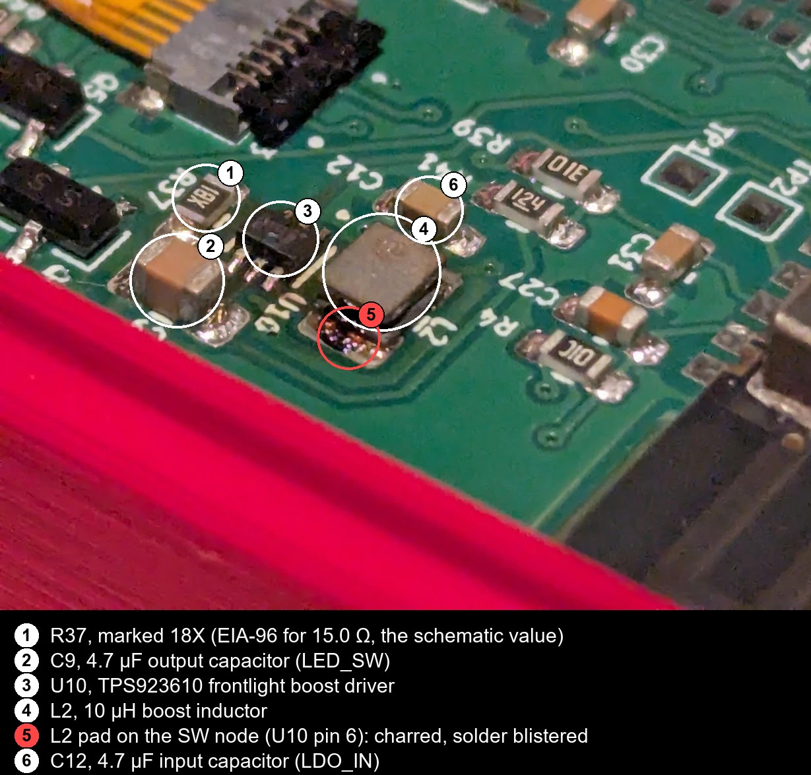
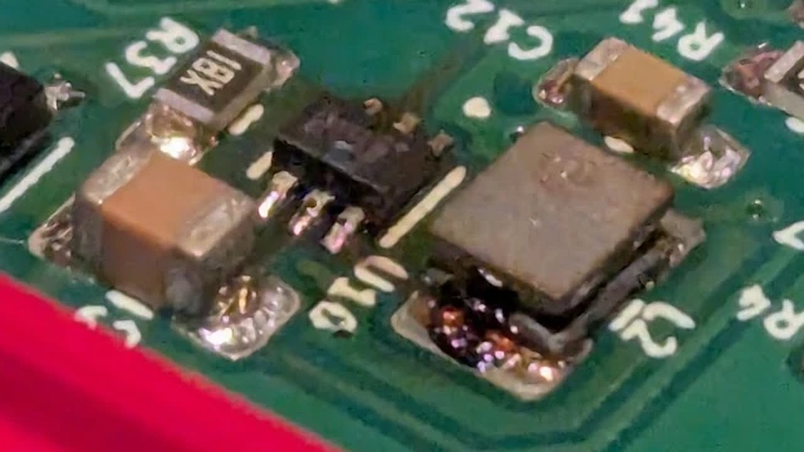
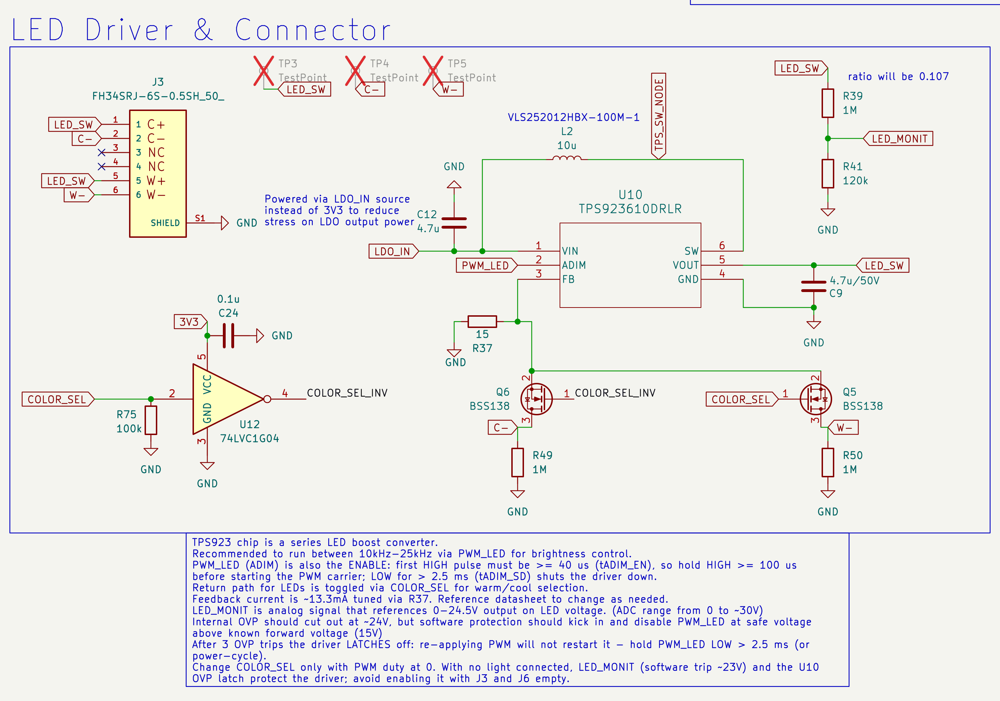

# Silkscreen — Board failures

Field-reported failures of Silkscreen boards: what the owner reported, what was measured afterwards,
what the design files and datasheets say about it, and whether the question is still open on the
current revision (Rev 1.02). Cases are added as they are reported and updated as boards are analysed.

Each statement in a case is one of four kinds, and the text says which:

- **Reported**: the owner's account.
- **Measured**: a reading taken by the owner or on the bench.
- **Derived**: read off the schematic, the layout, a datasheet or the firmware.
- **Inferred**: reasoned from the above and not measured.

A conclusion is called *established* only when it rests on measured or derived facts alone.

| Case | Revision | Reported | Symptom | Status |
|---|---|---|---|---|
| [1](#case-1-rev-10-frontlight-boost-fault) | 1.0, assembled by JLCPCB | 2026-10-23 | Smoke and charring at `L2`, `U10` and `C9` on a USB power-up with the battery unplugged | Open: the board is being returned for analysis |

---

## Case 1: Rev 1.0, frontlight boost fault

| | |
|---|---|
| **Revision** | 1.0 (files published 2026-09-21), assembled by JLCPCB |
| **Reported** | 2026-10-23 |
| **Outcome** | Smoke and charring at `L2`, `U10` and `C9`, starting 30–60 s after a USB-C cable was connected with the battery unplugged. The cable was removed. No fire or injury was mentioned in the report. |
| **Board state** | Case open, battery disconnected, not powered again as far as reported. Being sent to the maintainer for failure analysis. |
| **Status** | **Open.** The initiating cause has not been identified. |
| **Established** | A low-resistance path (≈6–7 Ω) to ground on the `L2` / `U10` SW-pin side of the frontlight boost. The USB input (`F1`), `C9` and the LED output net are intact. The battery pack is neither latched nor over-discharged (3.26 V). |
| **Not established** | What started the fault (`U10`, `C12` or a conductive char path); why the 67 W charger did not power the board overnight; why the browser flasher could not authenticate the board. |

### 1. What the owner reported

All of this is **reported**. The owner is not named and the account is condensed.

1. **Evening.** The board was connected to a 67 W USB-C wall charger (Anker) with a USB-C to USB-C
   cable. A font download was started from the settings, over Wi-Fi. The font-download screen has no
   frontlight controls, so the frontlight was left on. The owner expected the board to charge and to
   time out once the download had finished.
2. **Next morning.** The board did not respond to the buttons. The screen still showed the
   font-download completion message. The red USB LED (`D2`) was not lit.
3. **Computer.** The board was moved from the charger to a computer. `D2` lit, the board booted and
   was usable for a while. The battery indicator read 0% and no charging was noticed.
4. **Daytime.** The board was unplugged and left.
5. **Evening.** The owner tried to reflash the board from the browser flasher. The flasher reported
   that the device did not authenticate ("or something to that effect").
6. **Teardown.** The case was opened and the battery unplugged. The flashing problem persisted.
7. **Failure.** With no battery fitted, a USB-C cable was connected once more to retry the flash.
   After about 30–60 seconds the board began to smoke around `L2`, `U10` and `C9`, and the cable was
   removed. Which source that last cable was plugged into (the computer or the wall charger) has not
   been confirmed.
8. **Afterwards.** The pack was measured at 3.26 V and the readings in section 3 were taken.

### 2. Photos

Taken by the owner after the failure, with the case open and the battery unplugged. The red object in
the foreground is not part of the board. The connector at the top, with a flex fitted, is `J3` (the
frontlight connector), judging by its position.

*Figure 1. The failed area, annotated. [Original photo](board-failures/case-01/overview.jpg).*

*Figure 2. `C9`, `U10` and `L2`, enlarged 2×.*

What the photo shows:

- `R37` reads 18X, the EIA-96 code for 15.0 Ω, which matches the schematic.
- `C9` and `C12` show no cracking or charring.
- `U10`'s body is dark and shows no cracking. Its pins carry dark flux residue.
- One `L2` pad is charred and its solder blistered; the body is discoloured on that side. The other
  pad is clean.
- **Inferred:** the charred pad is the one on the SW node (`U10` pin 6), not the one on `LDO_IN`.
  The identification comes from matching the photo to the layout, using the positions of `R37`,
  `C9`, `C12`, `R39` and `R41` as reference points.
- Only this part of the board is photographed. Both sides of the whole board and magnified views of
  the `U10` pins are to be added when the board is received.

### 3. Measurements after the failure

**Measured** by the owner with a multimeter, board unpowered, USB and battery unplugged, black probe
on a mounting-hole pad as ground unless stated. The "healthy" column is **derived** from the
schematic and datasheets, not read from a reference board; it is to be replaced with readings from
healthy boards (section 7).

| # | Measurement | Reading | Healthy board | What it shows |
|---|---|---|---|---|
| 1 | Battery pack at the connector, at rest | 3.26 V | 3.0–4.2 V | A nearly empty, undamaged cell. Not latched at 0 V and not over-discharged. |
| 2 | `F1` (1 A PPTC), end to end | ≈0 Ω | 0.1–0.3 Ω | Conducting. Meter resolution not recorded. |
| 3 | `F1`, each end to ground | Hundreds of kΩ to MΩ, varying | ≈0.4 MΩ (`R38` + `R51`) or higher | The USB input net is not shorted. |
| 4 | `L2`, end to end | ≈0 Ω | ≈0.5 Ω (DCR 0.45 Ω typ, 0.54 Ω max) | Conducting. A coarse meter shows 0 for both an intact `L2` and one bridged by char; resolution not recorded. |
| 5 | `L2`, each pad to ground | ≈6–7 Ω at the charred pad (the owner had to scratch through char to make contact), ≈7 Ω at the other | Hundreds of kΩ or more | A low-resistance path to ground on the `LDO_IN` / SW-node network. |
| 6 | `C9`, lower end to ground | ≈0 Ω | 0 Ω (ground) | Reference. |
| 7 | `C9`, upper end (`LED_SW`) to ground | Starts high, settles at ≈0.6 MΩ | ≈1.1 MΩ (`R39` + `R41`), lower with `U10`'s own pin loading in parallel | `LED_SW` is not shorted. |
| 8 | `C9`, capacitance | 4.7 µF | 4.7 µF nominal | `C9` is intact. |

### 4. What the evidence shows

*Figure 3. The frontlight driver block (Rev 1.0 and Rev 1.02 are identical here).*

#### 4.1 Firmware behaviour that matters for the account

**Derived** from the firmware at the time of the report, with default settings:

- Below 3.4 V on battery, the boot-time check puts the board straight back to sleep without drawing
  the screen. With USB present the check is skipped.
- A normal timeout sleep draws the sleep image over the previous screen (default sleep timeout 10
  minutes).
- The frontlight comes back on at boot if it was on when power was lost (Restore Light on Wake is on
  by default).
- The battery indicator shows 0% for any pack below about 3.55 V. With USB present and the pack
  below 2.5 V it shows "No battery" instead of a percentage.

#### 4.2 The morning needs no hardware fault

- The pack is nearly empty and undamaged (3.26 V, measurement 1), so the 0% reading is expected, and
  so is a charge that cannot be seen on the display: 0% covers everything below about 3.55 V.
- `D2` was dark on the wall charger, so USB power was **not reaching the board** (reported). With no
  USB and a pack below 3.4 V, the boot-time check puts the board back to sleep each time a button
  wakes it, and the screen keeps its last image. That is "non-responsive" (**inferred**).
- The screen showed the download-completion message, not the sleep image. With default settings a
  normal timeout sleep would have replaced it, so the board did not finish a normal sleep: it lost
  power or reset and the boot-time check then slept it without redrawing (**inferred**).
- `D2` lit and the board booted on the computer because the boot-time check is skipped on USB
  power.
- The Wi-Fi, frontlight and charging load therefore ran for the length of the download and the sleep
  timeout, not for the night.

#### 4.3 The fault

- The USB input is intact: `F1` conducts and both its ends read high to ground (measurements 2, 3).
- The LED output is intact: `C9` reads 4.7 µF and ≈0.6 MΩ, and `LED_SW` is not shorted
  (measurements 7, 8).
- Both `L2` pads read 6–7 Ω to ground (measurement 5). They are joined by `L2` (≈0.5 Ω), so this is
  one network: `LDO_IN` and the SW node, which includes `U10`'s `VIN` and `SW` pins, `C12`, `L2`'s
  pads and any conductive char.
- At 5 V a 6–7 Ω path draws about 0.75 A and dissipates 3–4 W in the fault element (**derived**).
  That is below `F1`'s 1 A hold current and below any USB source's limit, so nothing upstream limits
  it. A fault that started at a higher resistance and fell as it heated would fit the 30–60 s before
  smoke (**inferred**).
- The charring is on `L2`'s SW-node pad, next to `U10` pin 6, and the readings (6–7 Ω there, 7 Ω at
  the other pad) are consistent with a short on the SW side. At this meter resolution they do not
  prove it (**inferred**; to be confirmed by isolating the parts, section 7).
- The frontlight was probably on during those 30–60 s, because it is restored at boot by default
  (**derived**). The earlier boots on the computer would have restored it too.

#### 4.4 Not explained

- Why the 67 W charger did not power the board (`D2` dark). Charger, cable, a low-load shut-off and a
  compatibility problem with this board are all possible. A bench test is pending (section 7).
- What started the input-side fault.
- Why the flasher could not authenticate the board. A flat pack on a weak port, brown-outs or
  corrupted state could each do it. Not investigated.

### 5. Considered and judged unlikely

| Hypothesis | Why it is judged unlikely |
|---|---|
| The overnight load (Wi-Fi download, frontlight, charging) damaged the board | The load ran for the download, not the night (4.2). It was well inside every rating on this branch: the light is about 0.2 W ([HARDWARE.md §7](HARDWARE.md#7-frontlight-driver)), and the system stack is analysed in [DESIGN_REVIEW.md §3](../DESIGN_REVIEW.md#3-usb-input-charging-mux-and-regulator). The pack shows no drain. |
| A leak on the LED output (`C9`, `D3`) ran away | `C9` reads 4.7 µF and ≈0.6 MΩ; `LED_SW` is not shorted. |
| The pack was drained by a leak and its protection latched | The pack reads 3.26 V. |
| The charge-enable limitation for latched packs ("Fix 4") | The pack is not latched, and the gate is open at 3.26 V ([DESIGN_REVIEW.md §4](../DESIGN_REVIEW.md#4-battery-protection-a-newly-identified-fault-path)). |
| USB hot-plug ringing | A USB-C source ramps VBUS after attach and does not overshoot; with no battery `U2` soft-starts, which is the gentlest case for `LDO_IN`; ringing lasts microseconds and the smoke began 30–60 s later; the hot-plug study keeps `LDO_IN` at or below about 5.6 V against `U10`'s 6 V limit ([HARDWARE.md §3.1](HARDWARE.md#31-usb-c-input--protection)). |
| `L2` was overloaded (saturation or rating) | At about 0.75 A `L2` is inside its 0.85 A rated current. The heat was in the fault element. |

### 6. Design scrutiny

#### 6.1 Rev 1.0, as built

Reference data: [TPS923610](https://www.ti.com/lit/ds/symlink/tps923610.pdf) (`VIN` absolute maximum
6 V, switch current limit 1.6 / 1.8 / 2.1 A min / typ / max, `SW` and `VOUT` 32 V); `L2` is the TDK
[VLS252012HBX-100M-1](https://datasheet.lcsc.com/datasheet/pdf/de422f385540fd5f1bb91cb97a2c323c.pdf?productCode=C88532)
(DCR 0.45 Ω typ / 0.54 Ω max, rated current 0.85 A for a 40 K temperature rise, saturation current
1.00 A, 1.30 A typ);
the 4.7 µH it replaced was the TDK
[VLS252010HBX-4R7M-1](https://datasheet.lcsc.com/datasheet/pdf/a25507d4dccbddd5db28734791dab924.pdf?productCode=C88528)
(DCR 0.208 Ω typ, rated 1.09 A).

| # | Aspect | Finding | Rev 1.0 | Rev 1.02 |
|---|---|---|---|---|
| 1 | Ratings on the boost input | `LDO_IN` is 5.5 V at most from USB and 4.2 V at most from the cell, against `U10`'s 6 V limit. The upstream clamp (`CR1`) starts at 7.2 V. No condition that exceeds a rating on this branch was found; the margin to 6 V is thin (≈0.5 V) and was accepted ([DESIGN_REVIEW.md §3](../DESIGN_REVIEW.md#3-usb-input-charging-mux-and-regulator)). | Not implicated; margin thin | Unchanged |
| 2 | USB hot-plug ringing | No `R84`. See section 5. | Judged unlikely here | `R84` fitted (worst stack-up 5.6 V on `U2` `VIN1`); closes the USB-A exposure; not relevant to this case |
| 3 | Containment on the boost branch | `F1` holds 1 A, trips at 1.95 A (0.65 A hold at 60 °C) and protects the whole board, whose illustrative worst-case load is about 650 mA. A 6–7 Ω fault draws about 0.75 A and dissipates 3–4 W: invisible to `F1` and to any USB source. The path `LDO_IN` → `L2` → `U10` body diode exists even when the driver is off ([HARDWARE.md §7](HARDWARE.md#7-frontlight-driver)). Nothing on the branch limits current. | **Design gap.** Sets the severity, not the cause. | Unchanged. **Open.** |
| 4 | `L2` selection (10 µH) | For a hard short the 10 µH heats about 1.6× as much as the 4.7 µH it replaced, and its solder reaches melting temperature at about 1.9–2.2 A instead of 2.4–2.8 A (estimate from TDK's temperature-rise rating). At about 0.75 A it is inside its rating. | Not the cause here; matters for hard shorts | Unchanged |
| 5 | Plug-in and battery hot-plug surge | A 2 V step on `LDO_IN` with the light off pushes about 0.9–1 A through `L2`, `U10`'s body diode and `C9` (simulation); a battery hot-plug about 2.5 A. Never measured ([DESIGN_REVIEW.md §8](../DESIGN_REVIEW.md#8-frontlight-sample-mapping-current-and-dynamic-behavior)). | Cannot be excluded | Unchanged (`R84` does not affect the battery path) |
| 6 | Blend mode | Colour select at 10 kHz, default warmth 50%. Documented as unvalidated; `L2` saturates (about 1.0 A) below `U10`'s 1.6–2.1 A limit ([HARDWARE.md §7](HARDWARE.md#7-frontlight-driver)). | Cannot be excluded | Unchanged |
| 7 | Charging and low-battery behaviour | Not implicated in the fault. It explains the dead-looking morning: a low pack with no USB gives no message. | Usability gap | Charge-enable gate now fed from `USB_VBUS`; same behaviour |
| 8 | USB-C source compatibility | `D2` was dark on a 67 W PD charger over C–C and lit on a computer. No design cause identified. | Open | Same CC network (`J1` is now an SMD receptacle). Open. |
| 9 | Assembly, parts, handling | JLCPCB-assembled. `U10` is a 0.5 mm-pitch SOT-563 with `SW`, `VOUT` and `GND` on adjacent pins, and is often out of stock at JLC ([BOM.md](../fabrication/BOM.md)); how this board's `U10` was sourced is to be confirmed. The owner opened the case before the failure (ESD, flexing). | Open, pending failure analysis | Same parts and process. Open. |

#### 6.2 Rev 1.02 (current)

A footprint and pad-net comparison of the Rev 1.0 files (the repository as of 2026-09-21, commit
`92b3e74`) against Rev 1.02 shows these changes: `R84` added (hot-plug damper in `C2`'s ground leg); `J1` changed from the through-hole
`USB4085` to a 12-pad SMD receptacle; `R79`–`R82` values changed; the charge-enable gate (`Q2`, `R81`)
fed from `USB_VBUS` instead of 3V3; assembly-offset fields; and ground-stitching vias below the cut
line (see the "Rev 1.02" note at the top of [HARDWARE.md](HARDWARE.md)).

Rev 1.02 has not been fabricated, so its status here comes from the design files and the analysis
above, not from field data.

The frontlight boost branch is **identical**: `U10`, `L2`, `C9`, `C12`, `D3`, `R37`, `R39`, `R41`,
`C31`, `Q5` and `Q6` have the same values and connections. Every open item above that concerns that
branch (3, 5, 6, 9) is therefore open on Rev 1.02 as well. Item 2 is closed for USB-A sources by
`R84` and was not implicated here. Item 7's cause is unchanged. Item 8 is open until the charger is
tested.

#### 6.3 Verdict as of the last update

- **Initiating fault: not identified.** On the evidence so far it is more likely a component,
  assembly or handling defect than a condition the schematic mishandles. The fault is on a net
  running inside its ratings; it appeared progressively, at the first power-up after the board had
  been opened and handled; and it sits at `U10`, a part with an open sourcing question. This is a
  lean, not a finding.
- **Severity: a design weakness.** One defect on this branch was able to run to smoke, because
  nothing limits current below `F1`'s 1 A hold (item 3). This applies to Rev 1.0 and Rev 1.02
  alike.
- **What would change the verdict:**
  - Other boards show the same signature (low `LDO_IN` to ground resistance, or extra idle draw):
    systematic, so part, process or design.
  - The failed part shows electrical overstress rather than a crack or an ESD signature, or the
    scope shows the plug-in surge or blend-mode stress above a rating: design.
  - The 67 W charger repeatedly fails to power a healthy board: input circuit or compatibility.

### 7. Open items

- **Failure analysis of the returned board.** Photograph both sides under magnification. Put 5 V
  from a current-limited supply (about 100 mA) into `LDO_IN` and read the drop across `L2`: about
  50 mV means current flows through `L2` (fault on the SW side), about 0 means the `LDO_IN` side or a
  bridged `L2`. Then lift `L2`, then `C12`, then `U10`, remeasuring each time, and open the failed
  part. Do not power the board from a stiff supply.
- **Source of `U10`.** Date code and lot, and how it reached the JLC build (stock, pre-order, global
  sourcing or consignment).
- **Screening of other boards.** `LDO_IN` to ground should be 100 kΩ or more and `LED_SW` to ground
  about 0.6–1.1 MΩ; record idle current at 5 V from a current-limited supply with the light off and
  on; soak the light for an hour or two in blend and in a single colour with a thermal camera.
- **Scope measurements.** The plug-in and battery hot-plug surge (`L2` current, `LED_SW`) and the SW
  node in blend mode, which are the two unmeasured items in section 6.1.
- **Charger compatibility.** Connect a board to a 67 W PD wall charger over C–C and watch `D2` at
  plug-in and again after the board sleeps.
- **From the owner.** The source of the final plug-in; whether the frontlight or screen was on during
  the 30–60 s; any smell or discolouration when the case was first opened; the `L2` readings again
  with decimals and the probes swapped.
- **Options under evaluation (no decision).** A current limit on the boost branch sized for its
  normal draw of about 0.1 A; a low-battery message before the board sleeps; a documentation note
  that a low pack with no USB looks like a dead board.

### 8. What to send with a failure report

- Photos of both sides of the board, in daylight, with close-ups of anything burnt.
- The revision on the title block, and who assembled the board.
- The charger and cable used, and whether `D2` was lit.
- What was on the screen and whether the frontlight was on.
- The pack voltage at the connector, measured at rest.
- With the board unpowered and USB and battery unplugged, using a mounting-hole pad as ground:
  `F1` end to end and each end to ground; `L2` end to end and each pad to ground; `C9` capacitance
  and each end to ground. Note the meter's resolution.

If a board smokes or smells hot, unplug USB and the battery at once. Do not power it again from a
stiff source; if it must be powered for diagnosis, use a bench supply set to 5 V and no more than
100 mA.

---

### Update log

- **2026-10-24.** Case 1 opened from the owner's report, the photo and the first multimeter readings.
  The board has not yet been received.
- **2026-10-24.** `L2`'s rated current corrected in HARDWARE.md section 7 and the BOM notes: 0.85 A
  (set by the 40 K temperature rise), where HARDWARE.md had quoted the 1.0 A saturation current as
  its rating.
