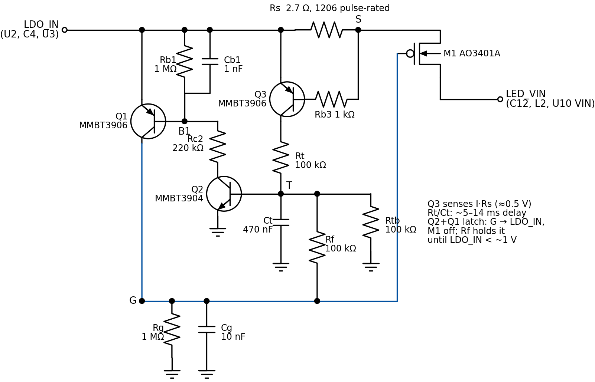

# Frontlight boost: a latching electronic fuse (design study, 2026-10-29)

> **Superseded as the lean** (same day): first by the [4-part current limiter](BOOST_LIMITER.md), then by a
> [single thermally placed PTC](PTC_THERMAL.md). This study stays as the reference for a circuit that
> switches a short off.

Board-failures case 1 ([BOARD_FAILURES.md](../BOARD_FAILURES.md#case-1-rev-10-frontlight-boost-fault))
ended with `U10`'s low-side switch shorted `SW` to `GND` at about 7 Ω. Nothing on the boost branch
limits current below `F1`'s 1 A hold, and no PTC can guarantee a trip on such a short from a
3.4–3.7 V cell: the polymer PTCs nearest the right trip current have resistance × trip current² of
about 0.53 W, which puts the best guarantee for a 7 Ω short at about 4.0 V ([section 6.4](../BOARD_FAILURES.md#64-mitigation-options-studied)).
The board has no spare GPIO, and BGA parts are ruled out.

This study designs a discrete latching electronic fuse for the boost feed, simulates it in LTspice
against faults and against everything that could trip it by mistake, and works through how it
affects the rest of the circuit. **Nothing here has been built or measured.** Every number is
simulated with generic models or derived from datasheets; section 8 lists what the bench must confirm
before a respin.

## 1. Summary

- **Recommendation: design M2** (`Rs` = 2.7 Ω, `Ct` = 470 nF). It trips on the case 1 short (7 Ω on
  the `SW` node) from a 3.0 V cell to USB, from −20 to 60 °C, in 4.7–13.4 ms, putting at most about
  11 mJ into the short (case 1 put roughly 100–200 J in). It also trips on shorts on `LED_VIN` (`C12`)
  and on `LED_SW` (`C9`, `D3`, `J3`), and on a board that is already shorted when power arrives. The
  largest `SW` short it is guaranteed to catch at 25 °C is 10.3 Ω at 3.0 V, 13.6 Ω at 3.7 V and
  19.7 Ω on USB; a short it misses dissipates at most 0.47–0.90 W, against 1.4 W for the best PTC
  and 3–4 W unprotected.
- **It did not trip by mistake** in any of its 444 non-fault runs: power-up, USB plug-in and unplug with
  and without a cell, single and repeated light start-ups up to 0.8 A, normal use, at −20, 25 and
  60 °C and both transistor corners. Supply events use at most 3 % of the trip margin; the hardest
  start-up case (0.2 A for 3 ms) uses 63 %.
- **The unknown is the light's real start-up current** at this board's 13.3 mA and 4.7 µF `C9`. A
  start above about 0.4 A from a cell at 3.4 V or below pulls `U10` into UVLO through `Rs`; the light
  then stutters and restarts by itself, without tripping the fuse. Measure it first (section 8); if
  starts are small, design B2 (3.3 Ω) buys more coverage.
- **Cost:** 14 parts (one AO3401A already on the BOM, three SOT-23 transistors, eight resistors, three
  capacitors; 0603 and one 1206), no GPIO, about 1 nA standby. In use it drops 67–115 mV at the
  50 % brightness cap and 135–243 mV at 100 %; the light draws 1.7–4 % more current at the cap, about
  1.1 % of total reading current at 3.7 V.
- **After a trip** the light is dead and the fuse draws 37–68 µA until both battery and USB are
  disconnected and `LDO_IN` falls below about 0.8–1.0 V. Firmware can see it on `LED_MONIT` and
  should tell the user; it cannot reset the fuse.
- **Layout is the open question:** the back of the board is crowded at both ends of the 56 mm feed,
  and the fuse needs roughly 40–50 mm².

## 2. Circuit

*Figure 1. The fuse between `LDO_IN` and the boost branch, with the recommended M2 values. The other
variants differ only in `Rs` (A/A2 2.0 Ω, B/B2 3.3 Ω) and `Ct` (100 nF in the first round). Drawn by
[`efuse-sim/draw_efuse.py`](efuse-sim/draw_efuse.py).*

**How it works.** In normal operation `M1`'s gate is held at ground by `Rg`, so `M1` is fully on and
nothing else conducts: every bias resistor has 0 V across it, and the fuse draws only junction
leakage. `Q3` watches the drop across `Rs`. Above about 0.5 V (0.19–0.21 A in M2 at 25 °C) it charges
`Ct` through `Rt`; when `Ct` reaches `Q2`'s threshold (about 0.46 V), `Q2` pulls `Q1`'s base down,
`Q1` pulls `M1`'s gate up to `LDO_IN`, and `M1` turns off. `Rf` then feeds `Q2`'s base from the gate,
so the latch holds itself until `LDO_IN` falls below about 1 V. `Rt`, `Ct` and `Rtb` set the delay:
5–14 ms for overloads above about 1.5× the threshold, longer just above it, so surges and start-ups
lasting a few ms cannot trip it. `Rb1`/`Cb1` keep `Q1` off and `Cg` keeps the gate low when `LDO_IN`
steps; `Rb3` limits `Q3`'s base current in a hard short.

| Ref | M2 value | Package | Part | Role |
|---|---|---|---|---|
| `Rs` | 2.7 Ω 1 % | 1206, pulse-rated | to select (section 5.5) | current sense; ≤ 21 mW in use; up to 4.6 W peak / 25 mJ in a hard short |
| `M1` | AO3401A | SOT-23 | `C15127` (Basic, already on the BOM) | series switch |
| `Q1`, `Q3` | MMBT3906 | SOT-23 | LCSC number to confirm | latch PNP; sense PNP |
| `Q2` | MMBT3904 | SOT-23 | `C20526` (Changjiang) | latch NPN |
| `Rb3` | 1 kΩ | 0603 | | `Q3` base current limit |
| `Rt`, `Rtb`, `Rf` | 100 kΩ | 0603 | | delay charge, delay bleed, latch hold |
| `Rc2` | 220 kΩ | 0603 | | `Q1` base drive |
| `Rb1`, `Rg` | 1 MΩ | 0603 | | hold `Q1` off; hold `M1` on |
| `Ct` | 470 nF X7R | 0603 | | delay |
| `Cg` | 10 nF | 0603 | | gate stays low on supply steps |
| `Cb1` | 1 nF | 0603 | | `Q1` stays off on supply steps |

## 3. Method

[`efuse-sim/run_efuse.py`](efuse-sim/run_efuse.py) builds LTspice decks and runs them in batch mode,
as the [SCH-2 study](../audit-2026-10-15/SCH-2_CHARGE_ENABLE.md) did. [`efuse-sim/summarize.py`](efuse-sim/summarize.py)
turns the results (`efuse-sim/results_*.json`) into [`efuse-sim/summary.md`](efuse-sim/summary.md), which
has every table. 2 451 runs:

| Group | Runs | Designs | What |
|---|---|---|---|
| threshold | 144 | A, B | trip current: load ramped 0 → 0.6 A over 300 ms |
| normal | 36 | A, B, as built | 50 % and 100 % duty at every supply; idle at 25 and 60 °C |
| nuisance | 864 | A, B | power-up, USB plug-in/unplug, single and repeated light starts |
| fault | 252 | A, B | shorts on `SW`, `LED_VIN`, `LED_SW`; at power-up; case 1 replay |
| release | 14 | A, B | latch release voltage |
| baseline | 23 | as built | the same shorts and surges without the fuse |
| variants | 810 | A2, M2, B2 | light starts and `SW` shorts with `Ct` = 470 nF |
| m2 | 308 | M2 | everything else for M2: supply events, other shorts, normal, release |

Designs: A, B = `Rs` 2.0 / 3.3 Ω with `Ct` 100 nF (first round); A2, M2, B2 = 2.0 / 2.7 / 3.3 Ω with
`Ct` 470 nF. `Ct` does not move the threshold, so M's threshold is A's scaled by 2.0/2.7.

- **Models.** `M1`: the repo's datasheet-fitted AO3401A. Transistors: the NXP 2N3904/2N3906 models
  (the MMBT parts are the same die) with `IS` ×3 and ÷3 for about ∓28 mV of V_BE spread, and NXP's
  BC847B/BC857B as a second family. Temperatures −20 to 85 °C.
- **`U10`** is behavioural: UVLO 2.40 V rising / 2.11 V falling (datasheet 2.3–2.49 / 2.05–2.17 V;
  results below flag anything under 2.17 V), body diodes on `SW`, 280 µA enabled, and an averaged
  input current at `VIN` (a start-up envelope, then a constant 0.235 W × duty). `C12` 2.5 µF and
  `C9` 3.5 µF effective, `L2` 10 µH / 0.45 Ω, `R39`/`R41`/`C31` as built.
- **Supplies.** `LDO_IN` behind 0.5 Ω (cell, `Q3`/`Q8`, `F2` and `U2`, or cable, `F1` and `U2`) with
  10 µF effective `C4` and a 40 mA 3V3 load. TPS2116 soft-start from 0 V (1.3 ms battery, 1.7 ms USB)
  and a 10 µs stress ramp; an 8 µs switchover between supplies and a 1 µs stress step.
- **Start-up envelopes.** TI's start-up curves are for a 60 mA, 1 µF evaluation board, so the light's
  turn-on is modelled as a constant input current for a fixed time, bounded by the 0.8 A soft-start
  switch limit: 0.8 A for 0.3 ms, 0.4 A for 0.5 and 1 ms, 0.2 A for 3 ms and 0.1 A for 5 ms, once
  and five times 10 ms apart. Charging `C9` to the string voltage takes about 0.3 mJ, so the 0.2 A ×
  3 ms case (about 2 mJ) is generous.

## 4. Results

### 4.1 Trip threshold

The threshold does not depend on the supply. It falls with temperature (V_BE, about −0.5 %/°C) and
spreads about ±5 % with the transistors.

| Design | −20 °C | 0 °C | 25 °C | 45 °C | 60 °C | 85 °C |
|---|---|---|---|---|---|---|
| A (2.0 Ω) | 0.31–0.34 A | 0.28–0.32 | 0.26–0.29 | 0.23–0.27 | 0.21–0.25 | 0.18–0.22 |
| **M (2.7 Ω)** | **0.23–0.25 A** | **0.21–0.23** | **0.19–0.21** | **0.17–0.20** | **0.16–0.18** | **0.13–0.16** |
| B (3.3 Ω) | 0.19–0.21 A | 0.18–0.19 | 0.16–0.18 | 0.14–0.16 | 0.13–0.15 | 0.11–0.14 |

Normal use draws at most 87.5 mA (M2, 100 % duty from a 3.0 V cell) and 41.6 mA at the 50 % cap. M's
lowest threshold, 0.13 A at 85 °C, leaves 49 % margin at 100 % duty and 3.1× at the cap.

### 4.2 Coverage

Largest short on the `SW` node guaranteed to trip, from the highest threshold at that temperature,
and the most a short just above that (so not tripping) can dissipate:

| Design | Temp | 3.0 V | 3.4 V | 3.7 V | 4.2 V | 5.0 V (USB) |
|---|---|---|---|---|---|---|
| A | 25 °C | 7.4 Ω / 0.61 W | 8.8 Ω / 0.73 W | 9.8 Ω / 0.81 W | 11.5 Ω / 0.96 W | 14.3 Ω / 1.19 W |
| **M** | **−20 °C** | **8.3 Ω / 0.52 W** | **9.9 Ω / 0.62 W** | **11.1 Ω / 0.69 W** | **13.1 Ω / 0.82 W** | **16.3 Ω / 1.02 W** |
| **M** | **25 °C** | **10.3 Ω / 0.47 W** | **12.2 Ω / 0.56 W** | **13.6 Ω / 0.62 W** | **15.9 Ω / 0.73 W** | **19.7 Ω / 0.90 W** |
| **M** | **60 °C** | **12.5 Ω / 0.43 W** | **14.7 Ω / 0.50 W** | **16.3 Ω / 0.56 W** | **19.0 Ω / 0.65 W** | **23.3 Ω / 0.80 W** |
| B | 25 °C | 12.6 Ω / 0.40 W | 14.8 Ω / 0.47 W | 16.5 Ω / 0.52 W | 19.4 Ω / 0.61 W | 23.9 Ω / 0.75 W |

For comparison: the best PTC (Littelfuse 0603L010 / Bourns MF-NSMF012/48X) guarantees 7 Ω only above
about 4.07 V and can leave up to 1.4 W untripped. The `SW`-short simulations agree with this table:
M2 misses 10 Ω only at 3.0 V and −20 °C, and 12 Ω only at 3.0–3.4 V at −20 °C and at 3.0 V at 25 °C.

### 4.3 Faults (M2)

Short switched on 10 ms after power-up, light off: delay to `M1` off / energy into the short / energy
in `Rs`, at 25 °C (full −20/25/60 °C tables in `summary.md`):

| Short on `SW` | 3.0 V | 3.4 V | 3.7 V | 4.2 V | 5.0 V (USB) |
|---|---|---|---|---|---|
| 0.05 Ω | 10.9 ms / 0 / 8 mJ | 9.5 ms / 0 / 10 mJ | 8.7 ms / 0 / 12 mJ | 7.6 ms / 0 / 15 mJ | 6.3 ms / 0 / 20 mJ |
| 0.5 Ω | 10.9 ms / 1 / 8 mJ | 9.5 ms / 2 / 10 mJ | 8.7 ms / 2 / 12 mJ | 7.6 ms / 3 / 15 mJ | 6.3 ms / 4 / 20 mJ |
| 3 Ω | 10.7 ms / 6 / 5 mJ | 9.3 ms / 7 / 6 mJ | 8.4 ms / 7 / 7 mJ | 7.3 ms / 8 / 7 mJ | 6.0 ms / 10 / 9 mJ |
| **7 Ω (case 1)** | **10.4 ms / 6 / 2 mJ** | **9.0 ms / 6 / 2 mJ** | **8.1 ms / 7 / 3 mJ** | **7.0 ms / 7 / 3 mJ** | **5.8 ms / 9 / 3 mJ** |
| 10 Ω | 10.3 ms / 5 / 1 mJ | 8.9 ms / 5 / 1 mJ | 8.0 ms / 6 / 2 mJ | 7.0 ms / 6 / 2 mJ | 5.7 ms / 8 / 2 mJ |
| 12 Ω | no trip, 189 mA | 8.9 ms / 5 / 1 mJ | 8.0 ms / 5 / 1 mJ | 6.9 ms / 6 / 1 mJ | 5.7 ms / 7 / 2 mJ |

- **Temperature.** At −20 °C the delays stretch to 7.2–14.0 ms (energy into the short up to 12 mJ;
  `Rs` up to 25 mJ in a dead short on USB); at 60 °C they shorten to 4.7–8.6 ms. Shorts just above
  the threshold trip slowly: 12 Ω at 3.7 V and −20 °C takes 70 ms (46 mJ).
- **Already shorted at power-up:** trips 6.9–11.8 ms after power is applied. The **case 1 replay**
  (USB, no battery, 7 Ω on `SW`, light restored at boot) trips in 6.9 ms with 7.8 mJ in the short,
  against 2.7 W continuous (187 mJ every 70 ms) without the fuse.
- **Short on `LED_VIN`** (a cracked `C12`, 0.5–7 Ω): trips at every supply, 5.8–10.9 ms.
- **Short on `LED_SW`** (`C9`, `D3`, `J3`), fed through `L2` and `U10`'s high-side body diode with the
  light off: trips at every supply for 0.5–7 Ω, 5.8–10.8 ms, except 7 Ω at 3.0 V, which sits just
  above the threshold and takes 57 ms (15 mJ). Design A misses that case entirely.
- **`LDO_IN` during the delay:** the deepest dip is 2.69 V (0.5 Ω on `LED_VIN`, 3.0 V cell), for
  about 11 ms. See section 5.3.
- **As built, the same shorts** run continuously: 7 Ω takes 371–618 mA (1.0–2.7 W), 0.5 Ω takes
  1.9–3.2 A and holds `LDO_IN` at 2.0–3.4 V.

### 4.4 Nuisance immunity

**Supply events** (M2: 252 runs; A and B: 504): power-up from 0 V with the TPS2116 soft-start and with a
10 µs stress ramp; USB plug-in with a cell at 3.0–4.2 V (8 µs switchover and a 1 µs stress step),
light off and on; USB unplug back to the cell. No latch in any run. The delay node peaked at 0.012 V
(M2) against a trip point of about 0.46 V, under 3 % of the margin.

**Light start-up.** This is where the first-round designs failed and why `Ct` went from 100 nF to
470 nF. Worst case over −20/25/60 °C and both transistor corners; "UVLO" marks a `U10` input below
2.17 V (the datasheet's worst falling threshold); the number in brackets is the worst delay-node
peak against a trip point of about 0.46 V:

| Start envelope | Design B (100 nF), 3.0 V | B, 3.7 V | **M2, 3.0 V** | **M2, 3.4 V** | **M2, 3.7 V** | **M2, 4.2 V** | **M2, USB** |
|---|---|---|---|---|---|---|---|
| 0.8 A, 0.3 ms | latched | UVLO | UVLO (0.12) | UVLO (0.06) | UVLO (0.05) | UVLO (0.04) | 2.35 V (0.04) |
| 0.4 A, 0.5 ms | latched | UVLO | UVLO (0.07) | UVLO (0.04) | 2.36 V (0.04) | 2.87 V (0.05) | 3.67 V (0.06) |
| 0.4 A, 1 ms | latched | UVLO | UVLO (0.21) | UVLO (0.09) | 2.36 V (0.08) | 2.87 V (0.09) | 3.67 V (0.10) |
| 0.2 A, 3 ms | latched | latched | 2.32 V (0.17) | 2.72 V (0.20) | 3.02 V (0.21) | 3.52 V (0.24) | 4.33 V (0.29) |
| 0.1 A, 5 ms | 2.59 V | 3.29 V | 2.65 V (0.00) | 3.05 V (0.00) | 3.35 V (0.01) | 3.85 V (0.01) | 4.65 V (0.01) |
| 5 × (0.4 A, 0.5 ms) | latched (60 °C) | UVLO | UVLO (0.10) | UVLO (0.05) | 2.36 V (0.05) | 2.87 V (0.05) | 3.67 V (0.06) |

- **M2 never latched on a start.** The tightest case is 0.2 A for 3 ms on USB at 60 °C (0.29 V, 63 %
  of the trip point).
- **UVLO is a functional limit, not a safety one.** A start of 0.4 A or more pulls `U10`'s input down
  by about 1.1 V through `Rs` (plus the 0.5 Ω source). `U10` drops into UVLO, stops drawing, recovers
  and restarts (datasheet 7.3.2); in the model the light still came on, in a few stutters. The PTC
  route has the same limit (BOARD_FAILURES section 6.4). A2 (2.0 Ω) sags less; B2 (3.3 Ω) sags more
  and latched on 0.4 A × 1 ms from 3.0 V, through repeated UVLO restarts.
- **Why the first round failed:** with `Ct` = 100 nF the delay was 1.1–3.7 ms, shorter than a 3 ms
  start, and B's 0.16–0.18 A threshold sits below 0.2 A. B latched on 0.2 A × 3 ms at every supply.

### 4.5 Latched state and reset

- Draw while latched: 37 µA at 3.0 V, 44 µA at 3.4 V, 48 µA at 3.7 V, 56 µA at 4.2 V, 68 µA on USB
  (`Rf`, `Rg`, `Rc2`). That roughly doubles the board's sleep drain while the fault stands; through
  the fuse alone a 500 mAh cell would last about a year.
- Reset: latched at 3.7 V, fault removed, supply pulled down for 50 ms: the fuse stays latched at
  1.0 V and above and releases at 0.8 V and below (A, B and M2). In practice: disconnect the battery
  and USB; `LDO_IN` then bleeds down through `U3`, the ESP32 and the fuse within seconds. Plugging or
  unplugging USB with the battery in does not reset it.
- If the short is still there, the fuse trips again 7–12 ms after power returns (section 4.3).

## 5. Effects on the rest of the circuit

### 5.1 `U10` and the frontlight

- **Input voltage.** `U10` sees `LDO_IN` minus 67–115 mV at the 50 % cap and 135–243 mV at 100 %.
  The lowest steady value is 2.70 V (100 %, 3.0 V cell), above the 2.17 V worst-case UVLO falling
  threshold and the 2.49 V worst-case rising one, so the light keeps running at any cell voltage.
- **Brightness and colour** do not change: the driver regulates LED current down to a 2.5 V input.
- **Start-up** is where the drop matters (section 4.4). Large starts from a low cell stutter through
  UVLO before running; this does not trip the fuse.
- **UVLO recovery.** `U10` restarts by itself when its input recovers (datasheet 7.3.2), and UVLO
  also clears its over-voltage latch (7.3.6), so a sagging start shows as a stutter, not a dead light.
- **`ADIM` while the fuse is latched.** `U10` then has no supply. `ADIM`'s absolute maximum is
  −0.3 to 5.5 V referenced to ground, with no dependence on `VIN` given, so driving `PWM_LED` is within
  ratings; firmware should still stop once it detects the fault (5.7).
- **Off-state path.** With the light off, `L2` and the high-side body diode still connect `LED_VIN` to
  `LED_SW` (HARDWARE.md section 7). The fuse is upstream and on, so `LED_SW` and `LED_MONIT` read as
  before (0.344 V at 3.7 V, with and without the fuse).

### 5.2 Surges into the boost branch (DESIGN_REVIEW section 8, BOARD_FAILURES 6.1 item 5)

`Rs` sits in series with `C12` and with the `L2` → body diode → `C9` path, so it damps the surges
flagged there as unmeasured:

- USB plug-in with a cell in (8 µs switchover, light off): peak into the branch 0.19–0.51 A as built,
  0.11–0.28 A with M2.
- Power-up from 0 V with a 10 µs stress ramp: 0.67–1.27 A as built, 0.45–0.78 A with M2. With the
  TPS2116's real 1.3–1.7 ms soft-start it is 55–66 mA.
- `L2` (1.0 A saturation) stays further from saturation on plug-in than it does today.

### 5.3 `LDO_IN`, `U2`, `U3` and the ESP32

- **Normal operation:** no effect. `C4` stays on `LDO_IN`; `U3`'s input is unchanged.
- **Fast transients:** `C12` (about 20 % of the effective capacitance on `LDO_IN`) now sits behind
  `Rs` (RC ≈ 7 µs), so it helps less during a TPS2116 switchover (6–8 µs). The switchover dip with a
  low cell can be slightly deeper; DESIGN_REVIEW section 13 already asks for that dip to be scoped,
  and the check should be repeated with the fuse fitted. In the simulations `U10`'s input stayed at
  2.69 V or above through every plug-in and unplug.
- **USB unplug:** `C12` back-feeds `LDO_IN` through `M1` (on, conducting both ways) for a few µs;
  `Q3`'s base–emitter junction is reverse-biased by at most about 1.3 V, far inside its 5 V rating.
- **During a fault (up to about 14 ms):** `LDO_IN` dips to 2.69 V at worst (hard short, 3.0 V cell).
  `U3` drops out and 3V3 can fall to about 2.5 V for those milliseconds, which may brown out the
  ESP32 (a reset, not damage). After the trip the board runs normally. As built, the same short holds
  `LDO_IN` at 2.0 V indefinitely, so the board cannot run at all.
- **Case 2** (a short on 3V3) is not covered: the fuse protects only what is downstream of it.

### 5.4 Protection devices

- **`F1`** (1 A hold, 1.95 A trip) and **`F2`** (0805L075, 0.75 A hold) take seconds to trip at the
  fuse's worst peak (1.32 A, M2) and see it for at most about 14 ms. Neither trips; the fuse acts first.
- **DW01A over-current** (about 150 mV across the FS8205A, a few amps) is not reached.
- **`D3`** (SMAJ26A on `LED_SW`): unchanged. A shorted `D3` is now one of the faults the fuse catches.

### 5.5 Sleep current, battery life, efficiency, heat

- **Sleep:** the fuse draws junction leakage only: 0.75 nA in the model, and at most about 0.15 µA
  even at the transistors' datasheet leakage limits (50 nA each, specified at 30 V), against a 48 µA
  typical floor (HARDWARE.md section 16). No change to the sleep budget beyond rounding. The
  `LED_MONIT` divider row (2.9 µA through the body diode) is unchanged.
- **Reading:** at the 50 % cap the light draws 1.7 % (USB) to 4.0 % (3.0 V cell) more current, 2.5 %
  from a 3.7 V cell; with the board's own 33–42 mA awake draw that is about 1.1 % of reading current
  at 3.7 V. At 100 % duty from a 3.0 V cell the light draws 8.8 % more.
- **Heat:** `Rs` dissipates at most 21 mW in use (100 %, 3.0 V). In a dead short on USB it peaks at
  4.6 W (1.31 A) and averages about 3 W over a delay of up to 8 ms, 25 mJ at −20 °C; from a cell the
  delay is longer (up to 14 ms) but the power lower (1.1 W from 3.0 V). A standard 1206 thick-film
  part may not carry that repeatedly: choose an anti-surge 1206 (or a 2010/2512) whose single-pulse
  curve covers about 5 W for 10 ms. `M1` dissipates under 1 mW in use and about 0.1 W during a
  hard-short delay.

### 5.6 EMI and stability

- `Rs` and `C12` form an RC filter at the converter's input. The 1.1 MHz ripple current now circulates
  in `C12` (≈0.06 Ω at 1.1 MHz) instead of partly along the 56 mm feed, which passes the ESP32 module:
  about 2 % of it reaches `Rs`. That should reduce conducted noise on `LDO_IN`.
- The filter cannot destabilise the boost: a boost is a negative incremental resistance of
  −V²/P ≈ −38 Ω (3.0 V, 0.235 W), and the filter's output impedance never exceeds `Rs` (2.7 Ω), about
  fourteen times smaller (Middlebrook). The feed's trace inductance (≈50 nH) against `C12` resonates
  near 450 kHz, and `Rs` damps it (Q ≈ 0.05).

### 5.7 Firmware

1. **Measure, then decide the turn-on sequence.** Keep the explicit `ADIM` enable pulse (≥ 40 µs).
   If the bench shows starts above about 0.3 A, start at a low duty (TI's 10 % start curve has about
   a quarter of the 100 % peak current) and ramp up over tens of ms; check that this lowers the start
   current on this board.
2. **Detect a trip.** With the light off and `LDO_IN` up, `LED_MONIT` normally reads 0.27–0.48 V
   (`LDO_IN` minus a diode, times 0.107, from a 3.0 V cell to USB). After a trip, `LED_SW` decays
   through `R39`/`R41` and `C9` (τ ≈ 4 s) to 0 V. With the light on, `LED_SW` collapses instead of
   sitting at the string voltage. Either way: stop `PWM_LED`, and tell the user the frontlight has a
   fault and the board must be disconnected from USB and the battery to reset it.
3. **Do not retry.** There is nothing to retry: the fuse stays latched until power is removed.
4. The existing rules stand (`ADIM` enable pulse ≥ 40 µs; `ADIM` low > 2.5 ms shuts `U10` down).

### 5.8 Layout and BOM

- **Placement.** Anywhere on the 56 mm front-copper feed between the via beside `U2`/`C4`
  (83.2, 86.1) and the via beside `C12` (52.0, 117.8), on the back. At the `U2` end the fuse also
  protects the feed itself. Both ends are crowded (7–9 back-side parts within 5 mm); the middle of the
  run passes the ESP32 module, whose body and antenna keep-out must be respected. Allow about
  40–50 mm² and a layout pass.
- **Keep `C12` behind the fuse,** at `U10`, as now: `U10` needs ≥ 1 µF effective at its `VIN`
  (datasheet 6.3), and the fuse relies on `C12` to absorb the switching ripple.
- **Kelvin-connect `Q3`** across `Rs` (emitter at the `LDO_IN` end of `Rs`, `Rb3` at the `M1` end) so
  trace resistance does not shift the threshold: 10 mΩ of shared copper moves it by about 0.4 %.
- **Keep `T`, `B1` and `G` short:** they are high-impedance (100 kΩ–1 MΩ), each with its own capacitor.
- **BOM:** 14 placements; `M1` and `Q2` are known JLC parts, `Q1`/`Q3` need an MMBT3906 part number,
  and `Rs` needs a pulse-rated part.

### 5.9 Failure modes of the fuse itself

| Failure | Effect |
|---|---|
| `Rs`, `M1` or `Q1` open; `Q2` or `Q3` collector–emitter short; `Ct` open | Light dead, or the fuse latches at power-up: fails safe |
| `M1` drain–source short; `Q3` or `Q2` open; `Ct` short | No protection: back to the as-built board, with no symptom |
| `Rf` open | Trips but does not hold: retries into a short every few tens of ms (reduced protection) |
| `Rg` open | Gate held only by `Cg` and leakage; `M1` may drift off: the light dims or dies |

The silent failures in the second row are why each board should be checked once (section 8).

## 6. What this does not cover

- **The cause of case 1.** The fuse limits the damage from a failed switch; it does not stop `U10`
  failing. The scope check of `L2` saturation (BOARD_FAILURES section 6.1 item 6) still stands.
- **Shorts above the coverage limit** (section 4.2): up to 0.47–0.90 W at 25 °C can still run in a
  short the fuse does not see. That heats `U10` (142.7 °C/W JEDEC) by up to about 65–130 °C: hot,
  but well short of the 3–4 W that charred case 1.
- **3V3 faults** (case 2) and anything upstream of the fuse.
- **The model:** generic BJT models with an assumed V_BE spread; a behavioural `U10` whose start-up is
  an assumed envelope; no thermal coupling between the short and the fuse; no ESD or EMC simulation;
  no tolerance stack on the resistors and capacitors (1 % and 10 % parts move the delay by about
  10 %, the threshold by 1 %).

## 7. Choosing between the variants

| | A2 (2.0 Ω) | **M2 (2.7 Ω)** | B2 (3.3 Ω) |
|---|---|---|---|
| Threshold, 25 °C | 0.26–0.29 A | 0.19–0.21 A | 0.16–0.18 A |
| 7 Ω on `SW`, 3.0 V to USB, −20 to 60 °C | Misses 3.0 V at −20 °C | Yes | Yes |
| 10 Ω on `SW` | Misses ≤ 3.4 V at 25 °C | Misses only 3.0 V at −20 °C | Yes |
| 7 Ω on `LED_SW` | Misses 3.0–3.4 V (A) | Yes (57 ms at 3.0 V) | Yes (B) |
| Worst untripped short, 3.7 V / USB, 25 °C | 0.81 / 1.19 W | 0.62 / 0.90 W | 0.52 / 0.75 W |
| Drop at 50 % / 100 % | ≈50–85 / 100–177 mV | 67–115 / 135–243 mV | ≈82–142 / 166–302 mV |
| False trip on any start envelope | None | None | 0.4 A × 1 ms from 3.0 V |
| UVLO sag on 0.4 A starts | 3.0 V only | ≤ 3.4 V | ≤ 3.7 V |

M2 is the balance: it closes the case 1 gap over the whole battery and temperature range without
tripping on any modelled start. If the bench shows start-up currents of 0.2 A or less, B2 adds
coverage at the cost of more drop; if it shows starts well above 0.4 A, A2 sags least.

## 8. Bench validation (before committing a respin)

1. **Start-up current.** On a good board, put a 0.1 Ω shunt in the feed and capture the current into
   `C12` at light turn-on (100 %, 50 % and a low-duty start) from 3.0 V and 4.2 V. Compare with the
   envelopes in section 4.4 and pick A2/M2/B2.
2. **Breadboard or dead-bug the fuse** with the chosen parts and check: the trip threshold at 25 °C and
   in a 60 °C oven; trip time and latch on 6.8 Ω and 10 Ω from a 3.0 V supply; no latch on repeated
   battery hot-plugs, USB plug-ins and light starts; latched current; reset voltage.
3. **First article with the fuse:** the same, plus the `LDO_IN` switchover dip with a 3.0 V cell
   (DESIGN_REVIEW section 13) and `LED_MONIT` after a deliberate trip.
4. **Per-board check in production:** from a 3.7 V supply, touch 6.8 Ω across `C12` for a moment; the
   light branch must drop within about 15 ms and stay off until the supply is removed. This catches
   the silent failures in section 5.9.
5. **`Rs` pulse rating:** confirm the chosen part's single-pulse curve covers about 5 W for 10 ms.

## 9. Files

- [`efuse-sim/run_efuse.py`](efuse-sim/run_efuse.py): decks and runner (LTspice 17, batch mode).
- [`efuse-sim/summarize.py`](efuse-sim/summarize.py) → [`efuse-sim/summary.md`](efuse-sim/summary.md): every table.
- `efuse-sim/results_*.json`: `.meas` results per run.
- [`efuse-sim/draw_efuse.py`](efuse-sim/draw_efuse.py) → [`efuse_schematic.png`](efuse_schematic.png).
