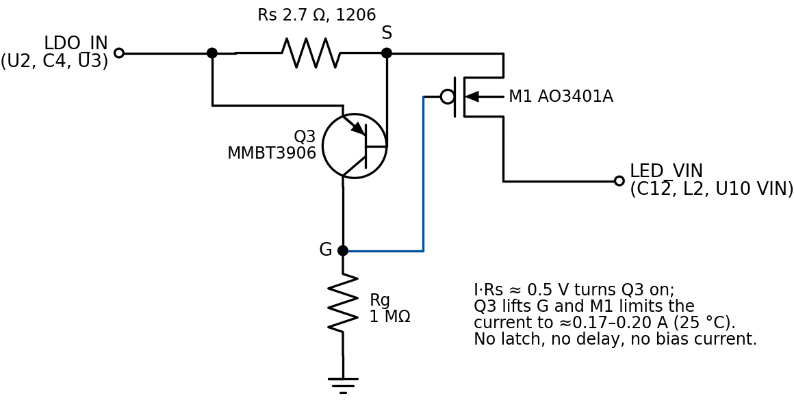

# Frontlight boost: a 4-part current limiter (design study, 2026-10-29)

> **Superseded as the lean** (same day) by a [single thermally placed PTC](PTC_THERMAL.md). This study
> stays as the fallback if the PTC's bench test disappoints.

The [latching fuse](BOOST_EFUSE.md) closes the case 1 gap, but it takes 14 parts. This study looks at
the smallest circuit that still keeps a shorted boost branch from overheating: a linear current
limiter of four parts. It was simulated with the same LTspice decks, models and cases as the latching
fuse (`efuse-sim/run_efuse.py limiter`, 774 runs, tables in [`efuse-sim/summary.md`](efuse-sim/summary.md)).
**Nothing here has been built or measured.**

## 1. Summary

- **Recommendation: L27.** `Rs` 2.7 Ω (1206), `M1` AO3401A (`C15127`, already on the BOM),
  `Q3` MMBT3906, `Rg` 1 MΩ (0603). No GPIO, no latch, no standby current.
- **What it does:** it caps the frontlight branch at 0.17–0.20 A at 25 °C (0.21–0.24 A at −20 °C,
  0.12–0.15 A at 85 °C), whatever the supply voltage. Normal use draws at most 87.5 mA (100 % duty
  from a 3.0 V cell), so it never acts in normal use. With the case 1 short (7 Ω on `SW`) the short
  gets 0.23–0.25 W instead of 1.0–2.7 W, from a 3.0 V cell to USB: below what charred case 1, at
  every battery voltage, which no PTC can guarantee.
- **What it does not do: switch off.** A sustained short keeps drawing about 0.19 A: a 500 mAh cell is
  flat in roughly 2 h (the DW01A then cuts it off), and `M1` dissipates 0.2–0.6 W with the 7 Ω short
  and up to 0.81 W in a dead short on USB (0.94 W at −20 °C). `M1` needs copper, and `Q3` should sit
  against it so the limit folds back as it heats (section 5.5).
- **It cannot trip by mistake:** there is nothing to trip. Supply events only see a gentler surge into
  the branch than today (USB plug-in 0.11–0.25 A instead of 0.19–0.51 A).
- **Start-up:** if the light's real start-up current is above the limit, `U10` sags into UVLO and
  restarts. In the more physical model the light still comes on within a few stutters; in a
  pessimistic model it can stay stuck restarting. **Measure the start-up current first** (section 8);
  below about 0.15 A there is no effect at all.
- **Cost in use:** the same as the latching fuse with 2.7 Ω: 67–115 mV drop at the 50 % cap,
  135–243 mV at 100 %; the light draws 1.7–4 % more current at the cap.

## 2. Circuit

*Figure 1. The limiter between `LDO_IN` and the boost branch. Drawn by
[`efuse-sim/draw_limiter.py`](efuse-sim/draw_limiter.py).*

`Rg` holds `M1`'s gate at ground, so `M1` is fully on and `Q3` is off: no bias current flows anywhere.
When the current through `Rs` reaches about 0.5 V / 2.7 Ω, `Q3` turns on and pulls the gate up just
enough that `M1` passes no more than that current; the rest of the supply voltage drops across `M1`.
When the overload goes, `Q3` turns off and `M1` is fully on again. The loop was stable in every run
(no oscillation in the last 2 ms of any fault run).

| Ref | Value | Package | Part | Note |
|---|---|---|---|---|
| `Rs` | 2.7 Ω 1 % | 1206 | to select | 0.10 W while limiting at 25 °C, 0.14 W at −20 °C |
| `M1` | AO3401A | SOT-23 | `C15127` (Basic, on the BOM) | absorbs a short: see 5.5 |
| `Q3` | MMBT3906 | SOT-23 | LCSC number to confirm | Kelvin across `Rs`; thermally coupled to `M1` |
| `Rg` | 1 MΩ | 0603 | | gate pull-down |

## 3. Choosing `Rs`

| | L22 (2.2 Ω) | **L27 (2.7 Ω)** | L33 (3.3 Ω) |
|---|---|---|---|
| Limit, −20 / 25 / 60 / 85 °C | 0.26–0.29 / 0.21–0.25 / 0.17–0.21 / 0.15–0.19 A | 0.21–0.24 / 0.17–0.20 / 0.14–0.17 / 0.12–0.15 A | 0.17–0.19 / 0.14–0.16 / 0.12–0.14 / 0.10–0.12 A |
| Margin at 85 °C, 100 % duty from 3.0 V (≈88 mA) | 1.69× | 1.35× | 1.08× (too tight) |
| Case 1 short (7 Ω), power in the short, 3.0 V → USB | 0.34–0.38 W | 0.23–0.25 W | 0.15–0.17 W |
| `M1`, dead short on USB, 25 °C / −20 °C | 0.98 / 1.14 W | 0.81 / 0.94 W | 0.67 / 0.78 W |
| Worst power in any short, 25 °C | 0.92 W (20 Ω, USB) | 0.72 W (20 Ω, USB) | 0.48 W (20 Ω, USB) |
| Drop at 50 % / 100 % duty | 55–94 / 110–196 mV | 67–115 / 135–243 mV | 82–142 / 166–302 mV |
| Start currents it passes without sagging | ≤ about 0.21 A | ≤ about 0.17 A | ≤ about 0.14 A |

L27 is the balance: L22 heats `M1` past 1 W on USB, and L33 leaves almost no margin at 100 % duty in
a hot case. If the bench shows small start-up currents and you keep the 50 % cap, L33 halves the heat.

## 4. Results (L27)

### 4.1 Sustained short on the `SW` node (25 °C), steady state

Current / power in `M1` / power in the short:

| Short | 3.0 V | 3.4 V | 3.7 V | 4.2 V | 5.0 V (USB) |
|---|---|---|---|---|---|
| 0.05 Ω | 181 mA / 0.42 / 0.00 W | 183 mA / 0.50 / 0.00 W | 185 mA / 0.55 / 0.00 W | 187 mA / 0.65 / 0.00 W | 189 mA / 0.81 / 0.00 W |
| 3 Ω | 181 mA / 0.32 / 0.10 W | 183 mA / 0.40 / 0.10 W | 185 mA / 0.45 / 0.10 W | 187 mA / 0.55 / 0.10 W | 189 mA / 0.70 / 0.11 W |
| **7 Ω (case 1)** | **181 mA / 0.19 / 0.23 W** | **183 mA / 0.26 / 0.24 W** | **185 mA / 0.32 / 0.24 W** | **187 mA / 0.41 / 0.24 W** | **189 mA / 0.56 / 0.25 W** |
| 10 Ω | 181 mA / 0.09 / 0.33 W | 183 mA / 0.16 / 0.34 W | 185 mA / 0.21 / 0.34 W | 187 mA / 0.30 / 0.35 W | 189 mA / 0.45 / 0.36 W |
| 15 Ω | 159 mA / 0.00 / 0.38 W | 180 mA / 0.00 / 0.49 W | 185 mA / 0.04 / 0.51 W | 187 mA / 0.13 / 0.52 W | 189 mA / 0.27 / 0.54 W |
| 20 Ω | 126 mA / 0.00 / 0.32 W | 142 mA / 0.00 / 0.41 W | 155 mA / 0.00 / 0.48 W | 176 mA / 0.00 / 0.62 W | 189 mA / 0.09 / 0.72 W |

- **As built, the same shorts** take 371–618 mA with 7 Ω (1.0–2.7 W in the short) and 1.9–3.2 A with
  0.5 Ω.
- **Above about V / 0.19 A** (15–20 Ω and up) the limiter no longer acts, and the short sees what it
  would see without it: 0.4–0.7 W. Every current-based protection has such a ceiling; the latching
  fuse's is 0.47–0.90 W and the best PTC's 1.4 W.
- **Temperature:** at −20 °C the limit rises to about 0.22 A (7 Ω at 3.7 V: 0.35 W in the short,
  0.29 W in `M1`); at 60 °C it falls to about 0.16 A (0.17 W in the short).
- **Other locations:** a short on `LED_VIN` (`C12`) or on `LED_SW` (`C9`, `D3`, `J3`, fed through the
  body diode) is held to 181–189 mA the same way: 0.23–0.25 W in a 7 Ω short, up to 0.81 W in `M1`.
- **The board keeps running:** the branch takes at most about 0.23 A, so `LDO_IN` stays at 2.89 V
  (3.0 V cell), 3.59 V (3.7 V cell) or 4.89 V (USB). The ESP32 stays up and can tell the user. As
  built, a hard short holds `LDO_IN` at 2.0–3.4 V.

### 4.2 Supply events

Power-up from 0 V (TPS2116 soft-start and a 10 µs stress ramp), USB plug-in with a cell, USB unplug:
peak current into the branch 0.05–0.16 A at power-up (as built: 0.67–1.27 A on the 10 µs ramp),
0.11–0.25 A on plug-in (0.19–0.51 A as built). `U10`'s input never fell below 2.70 V.

### 4.3 Light start-up

Two models of the light's turn-on (`U10` is behavioural; its real start-up current at this board's
13.3 mA and 4.7 µF `C9` is not known):

- **Energy model** (the more physical one): the start-up current flows until the energy to charge `C9`
  (0.3–0.6 mJ) has gone in, and that progress survives a UVLO restart because `C9` keeps its charge.
  **The light starts at every supply**, 25 °C and 60 °C. Starts above the limit (0.2–0.8 A) dip `U10`
  into UVLO once or twice (input 1.94–2.10 V; on 96–98 % of the time after enable).
- **Time model** (pessimistic): the start-up current flows for a fixed time after every restart, so a
  restart does not count earlier progress. Of the 40 runs with a start above the limit (25 and 60 °C),
  24 left `U10` restarting until the end; 0.1 A starts are unaffected.

Which one is closer to the board depends on how `U10`'s soft-start behaves after a UVLO restart, which
the datasheet does not describe. A bench measurement settles it (section 8).

## 5. Effects on the rest of the circuit

### 5.1 `U10` and the frontlight

Identical to the latching fuse with `Rs` = 2.7 Ω: `U10` sees `LDO_IN` minus 67–115 mV at the 50 %
cap and 135–243 mV at 100 %; the lowest steady value is 2.70 V (100 %, 3.0 V cell), above the 2.17 V
worst-case UVLO threshold; brightness and colour do not change; `LED_MONIT` reads as before with the
light off (0.344 V at 3.7 V). Start-up is the difference (4.3). `ADIM` stays within its ratings even
if `LED_VIN` collapses (its absolute maximum is referenced to ground).

### 5.2 Surges into the boost branch

The limiter caps the `L2` → body diode → `C9` surge (DESIGN_REVIEW section 8, BOARD_FAILURES 6.1
item 5) as well as any fault: 0.11–0.25 A on USB plug-in and at most 0.16 A at power-up, against
0.19–0.51 A and up to 1.27 A today. `L2` (1.0 A saturation) stays well clear of saturation.

### 5.3 `LDO_IN`, `U2`, `U3` and the ESP32

- **Normal operation:** no effect; `C4` stays on `LDO_IN`.
- **Fast transients:** as with the latching fuse, `C12` sits behind `Rs` (RC ≈ 7 µs) and helps less
  during a TPS2116 switchover; repeat the DESIGN_REVIEW section 13 switchover scope check.
- **During a fault:** unlike the latching fuse, there is no millisecond dip: the branch never takes
  more than 0.31 A even in the first microseconds, so `LDO_IN` and 3V3 stay up and the ESP32 keeps
  running.
- **Case 2** (a short on 3V3) is not covered.

### 5.4 Protection devices

`F1`, `F2` and the DW01A never see more than 0.31 A from the branch, so none of them trips. That
is the price of not switching off: today a hard short on the battery would eventually trip `F2` (0.75 A
hold) or the DW01A; with the limiter the short is held at 0.19 A until the cell reaches the DW01A's
over-discharge cut-off, about 2 h for 500 mAh.

### 5.5 Heat in `M1` and `Rs`

- `M1` dissipates (V − I·(Rs + short)) × I while limiting: 0.19–0.56 W with the case 1 short, at most
  0.81 W (dead short on USB, 25 °C) and 0.94 W at −20 °C, where the limit is higher.
- On the datasheet's 1 in² of 2 oz copper (100–125 °C/W steady state) 0.81 W is +80–100 °C. On this
  board's smaller pads it would be more, so:
  - **give `M1`'s drain (`LED_VIN`) a copper pour** as large as the back allows, and
  - **put `Q3` against `M1` on shared copper.** `Q3`'s V_BE falls about 2 mV/°C, which lowers the
    limit about 0.5 %/°C (the simulated limit falls 17 % from 25 to 60 °C). As `M1` heats, the limit
    folds back. At 150 °C/W the dead-short-on-USB case would settle near +80 °C instead of +120 °C if
    `Q3` followed `M1`'s temperature (inferred; `Q3` will run cooler than `M1`'s junction).
- `Rs` takes 0.10 W while limiting at 25 °C and 0.14 W at −20 °C: a 1206 (0.25 W) is enough. There is
  no pulse to rate it for: the current never exceeds 0.31 A.
- In normal use `M1` and `Rs` dissipate about 21 mW together at most.

### 5.6 Sleep current, battery, EMI, stability

- **Sleep:** with `Q3` off there is 0 V across `Rg`; the circuit draws only `Q3`'s and `M1`'s leakage
  (0.00 nA in the model, under 0.1 µA at datasheet limits). No change to the 48 µA sleep floor.
- **Reading:** the light draws 2.5 % more current at the 50 % cap from a 3.7 V cell (about 1.1 % of
  total reading current), as with the latching fuse.
- **EMI:** `Rs` and `C12` filter the converter's input as described for the latching fuse; less
  1.1 MHz ripple reaches the 56 mm feed.
- **Stability:** no oscillation in any run. The input filter cannot destabilise the boost (`Rs`, 2.7 Ω,
  is about 14 times smaller than the boost's −38 Ω incremental input resistance). The `Q3`–`M1` loop
  should still be checked with a scope on the bench.

### 5.7 Firmware

1. **Detect a held short.** With the light off, `LED_MONIT` normally reads 0.27–0.48 V. With a short on
   the branch, `LED_VIN` drops to I × R (≈1.3 V for 7 Ω, near 0 for a hard short) and `LED_SW` decays
   through `R39`/`R41` and `C9` (τ ≈ 4 s) to about that minus a diode, so `LED_MONIT` falls below about
   0.1 V within 10–20 s (derived, not simulated over that time). With the light on, the boost output
   collapses at once.
2. **Act on it:** stop `PWM_LED`, tell the user the frontlight has a fault, to unplug USB and not to
   leave the battery in. The board can stay up to show this; consider deep sleep afterwards.
3. **Start-up:** keep the `ADIM` enable pulse; if the bench shows starts above the limit, start at a
   low duty and ramp up, and check that it lowers the start current.
4. Nothing to reset: the limiter recovers by itself when the short goes.

### 5.8 Layout and BOM

- Four parts, about 15–20 mm² before the copper pour for `M1`.
- Anywhere on the 56 mm feed; at the `U2` end it also protects the feed itself.
- Kelvin-connect `Q3` across `Rs`; 10 mΩ of shared copper moves the limit about 0.4 %.
- Keep `C12` behind the limiter, at `U10`.
- `M1` is a known Basic part; `Q3` needs an MMBT3906 part number; `Rs` is a commodity 1206.

### 5.9 Failure modes

| Failure | Effect |
|---|---|
| `Rs` or `M1` open; `Q3` collector–emitter short | Light dead: fails safe |
| `M1` drain–source short; `Q3` open | No limit: back to the as-built board, no symptom |
| `Rg` open | Gate held by leakage only: the light may not turn on |

Per-board check: from a 3.7 V supply, put 6.8 Ω across `C12`; the supply current must settle at about
0.18 A plus the board's own draw (and about 0.5 V across `Rs`). That catches the silent failures.

## 6. What this does not cover

- **Switching the fault off.** A held short drains the battery and keeps `M1` hot until someone
  disconnects it. Firmware can warn; it cannot stop it.
- **Shorts of 15–20 Ω and above**, which the limiter does not reach (0.4–0.7 W).
- **The cause of case 1** (`U10`'s failed switch; the `L2` saturation question in BOARD_FAILURES 6.1).
- **3V3 faults** (case 2).
- **The model:** generic BJT models with an assumed V_BE spread, a behavioural `U10` and an assumed
  start-up envelope, no electro-thermal simulation of `M1` and `Q3`, no ESD or EMC simulation.

## 7. Against the other options

| | PTC (MF-NSMF012/48X) | **4-part limiter (L27)** | Latching fuse (M2) |
|---|---|---|---|
| Parts | 1 | **4** | 14 |
| Case 1 short (7 Ω) from a 3.0–3.7 V cell | not guaranteed (needs 4.08 V) | held: 0.23–0.24 W in the short (25 °C) | off in 6.5–13.4 ms |
| Case 1 short on USB | trips | held: 0.25 W in the short, 0.56 W in `M1` | off in 4.7–7.2 ms |
| After a sustained short | tripped: ~120 mA, 100–125 °C spot | held at ~0.19 A; `M1` 0.2–0.8 W; cell flat in ~2 h | off; 37–68 µA |
| Worst short it does not stop, 25 °C | 1.4 W | 0.72 W | 0.90 W |
| Can trip by mistake | at 100 % duty when hot (0603L010) | no | not in any simulated case |
| Start-up sensitivity | sag through up to 6.5 Ω | stutter above ~0.17 A | stutter above ~0.4 A |
| Standby | 0 | ~0 | ~1 nA |
| Reset | by itself, once cool | by itself | disconnect battery and USB |

## 8. Bench validation

1. **Start-up current:** shunt the feed on a good board and capture the current at light turn-on at
   100 %, 50 % and a low-duty start, from 3.0 V and 4.2 V. Below about 0.15 A, the limiter is invisible
   in use. Above it, check how `U10` restarts after a UVLO dip.
2. **Breadboard the four parts** and measure the limit at 25 °C and in a 60 °C oven, the drop at 90 mA,
   and `M1`'s temperature with a dead short on 5 V, with and without `Q3` thermally coupled to it.
3. **First article:** the same in the board's own layout and copper; the switchover dip with a 3.0 V
   cell; `LED_MONIT` with 6.8 Ω across `C12` for a minute.
4. **Per board:** the 6.8 Ω check in section 5.9.
